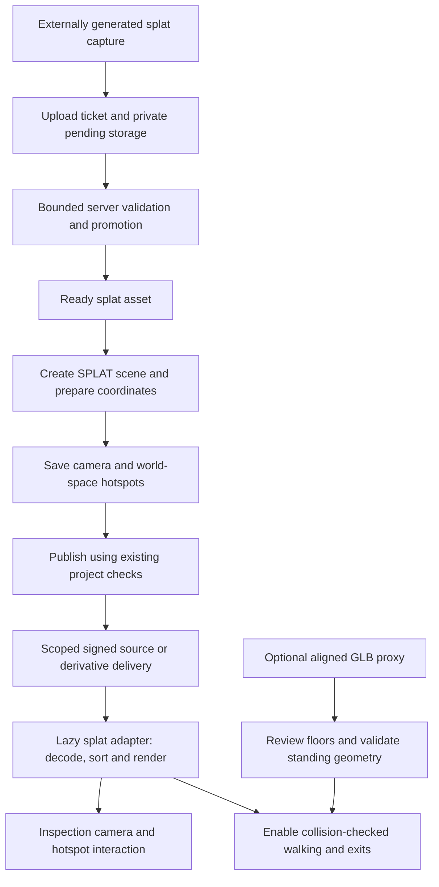

# 3D Gaussian Splatting — phased implementation plan

Status: Phases 0–2 implemented locally: renderer proof, SPLAT contracts, bounded raw upload admission and private source delivery. Phase 0 representative reconstructed-capture and physical-device acceptance remains pending. Shared tour viewing/authoring starts in phases 3–5; phases 3–9 remain pending. See [implementation evidence and supported profile](docs/splat-feasibility.md).

Goal: Extend Virtual Tour Studio so authors can upload an externally reconstructed Gaussian-splat capture, prepare its coordinates, save views, place hotspots and publish it through the existing private-storage delivery flow. Add reviewed walking with a separate aligned collision model after the viewing release is accepted.

Related documentation: [technical architecture](technical.md), [performance plan](performace_phase.md), [runtime assets](docs/runtime-assets.md), [GLB chunking plan](rendering_pland_phase.md).

## Scope and release boundaries

| Release | User outcome | Included phases |
| --- | --- | --- |
| Viewing MVP | Upload an existing splat capture, inspect it, save a camera, add information/navigation hotspots, preview and publish | 0–5 |
| Performance and rollout | Bounded loading, disposal, quality controls, device measurements and explicit deployment rollback | 6–7 |
| Reviewed walking | Attach and align a GLB collision/occlusion proxy, approve floors, walk and use explicit exits | 8 |
| Optional extensions | Derived LOD/streaming, layout placements or photo-to-splat reconstruction | 9; separately scoped work |

The MVP uses already generated captures. Training from photos/video requires a separate GPU processing pipeline and is outside its scope. Mesh materials, texture painting, embedded GLB animation and GLB chunk partitioning remain features of their existing asset paths. A splat scene exposes controls that its renderer actually supports.

## Current foundation and required extensions

| Concern | Existing implementation | Planned extension |
| --- | --- | --- |
| Frontend | React, React Three Fiber and Three.js | Lazy-loaded splat renderer adapter inside the shared viewer |
| Assets | Validated GLB, panorama, image and texture roles | Explicit splat asset role and bounded format validation |
| Scenes | `3D`, `PANORAMA`, `LAYOUT`, `SPLAT` | Versioned splat inspection settings; shared renderer integration pending |
| Storage | Pending uploads, conditional promotion, private signed reads | Reuse transport and privacy checks with splat-specific content handling |
| Publication | Published-project and referenced-asset checks | Include splat sources and later collision/occlusion references |
| Processing | Node worker with attempt/lease-owned derivatives | Separate versioned splat products only if conversion is needed |
| Navigation | Triangle indexes, reviewed floors and clearance | Separate authored GLB proxy; visual splats grant no standing permission |
| Cleanup | Owned browser caches and durable storage retirements | Splat decoder/worker/GPU ownership and registered derivative keys |

`SPLAT` and the raw `splat-v1` admission profile are implemented. Later derivative products and rollout flags remain design names, not existing APIs or environment variables.

## Architecture and data flow

Original uploads remain immutable. Source identity is the asset UUID and verified content hash, not the expiring signed URL. Any derived products remain children of the source asset and publish only after complete validation.

## Requirements across all phases

- Keep existing GLB, panorama and layout scenes readable and behaviorally compatible.
- Preserve private bucket delivery and same-project references; public access must recheck publication and actual asset references.
- Do not fetch arbitrary URLs embedded in uploaded files. Initial support accepts self-contained captures only.
- Bound source size, decoded splat count, decompressed bytes, attribute dimensions and execution time. File size alone does not bound memory.
- Apply one documented transform for source units, axis correction, rotation and position. Cameras, hotspots and proxies must agree on prepared world coordinates.
- Keep renderer/decoder dependencies local and pinned after compatibility review.
- Record loading errors and provide retry without silently enabling incomplete navigation.
- Release decoder tasks, sort workers, subscriptions, CPU buffers and GPU allocations when their last owner leaves.
- Do not claim mobile compatibility, visual quality or performance budgets before representative-device measurements.
- Distinguish loaded visuals, hotspot occlusion and approved collision geometry.

## Phase 0 — Renderer and format feasibility

Status: Local implementation complete; representative reconstructed indoor capture and physical-device acceptance pending. Selected the installed MIT Drei 10.7.9 shader/sorter with Three 0.186.1 and Fiber 9.8.1; raw 32-byte `.splat` profile. [Proof, limits and measured synthetic baseline](docs/splat-feasibility.md).

Evaluate a Three.js-compatible renderer, with [Spark](https://sparkjs.dev/docs/overview/) as an initial candidate. Its documentation describes a Three.js/WebGL2 renderer; integration with this application's installed Three.js version, Fiber frame scheduling and resource ownership still requires a local proof. Review its license and any decoder/conversion dependencies before selecting and pinning versions.

Choose one exact initial format profile after testing real exports. A Gaussian PLY profile is a candidate; ordinary point-cloud PLY is not automatically a Gaussian capture. Additional compressed formats require their own validator and decoder acceptance. Document supported attributes, encodings, compression, coordinate conventions and rejected variants.

Build a local proof with a small known-good capture and a representative indoor capture. Check depth composition with opaque meshes, camera motion, transparency/sorting artifacts, exposure/color handling, demand rendering, resize, background-tab restoration and teardown. Determine when asynchronous decoding/sorting must invalidate Fiber frames and whether antialiasing or other renderer settings require a splat-specific policy.

Acceptance:

- [x] Selected dependency versions, license and format profile recorded.
- [x] Local viewer renders fixtures using the installed application stack.
- [x] Camera changes and asynchronous sort completion render correctly.
- [x] Mount/unmount and context-loss behavior have an explicit recovery strategy.
- [ ] Representative real-capture/device baselines record source bytes, decoded count, first usable frame, CPU/GPU estimates and camera-motion frame times. Synthetic local baseline is recorded; real-capture and device review is outstanding.

## Phase 1 — Asset, scene and settings contracts

Status: Implemented and verified against local PostgreSQL, including existing-data migration regressions. Uses the selected Phase 0 raw profile.

Define a logical `SPLAT` asset role and `SPLAT` scene type. Add a new migration rather than editing applied migrations. Update asset/scene check constraints, same-project asset-kind checks, generated SQL queries, Go models and frontend unions. Require a ready splat asset for a splat scene.

Define versioned scene settings: source transform, supported view controls, background/exposure and inspection camera bounds. Reuse the existing 3D position/yaw/pitch convention where appropriate. Keep mesh material assignments and walking settings unavailable until their relevant support exists. Decide how transform edits reposition saved views and hotspots, and how later proxy approvals are invalidated.

Update API contracts, validation and `docs/openapi.yaml`. Inspect every scene-type switch, including camera saves, publication, deletion, navigation destinations, imports and viewer routing.

Acceptance:

- [x] Existing documents decode unchanged and migrations work against existing data.
- [x] Incorrect asset kind, pending source and cross-project references are rejected.
- [x] Settings reject invalid/non-finite transforms and unsupported fields.
- [x] Scene and camera round trips preserve coordinates.

## Phase 2 — Upload admission and private delivery

Status: Implemented and verified against local MinIO/PostgreSQL and browser CORS. Raw sources use SHA-256 metadata and immutable conditional promotion; retries preserve the promoted bytes after database failure. Production-origin S3 CORS remains deployment acceptance.

Extend the existing ticket → signed POST → completion flow with format-specific extension, content type, storage-key and size handling. Browser checks give early feedback; authoritative bounded validation happens before pending bytes are promoted. The current GLB/image validators cannot validate a splat source.

Validate the selected format's header/schema, required attributes, record counts, finite values, valid scale/rotation/opacity encoding and exact payload structure. For compressed formats, check decoded limits in a bounded decoder. If inspection needs a subprocess, give it explicit concurrency, timeout and memory controls. Recheck the inspected pending object's identity before promotion.

Reuse ready-asset signed reads, project deletion and retirement. Raw source delivery must be usable independently of optional conversion. Review browser CORS and secure-context requirements using existing MinIO and S3 deployment paths.

Acceptance:

- [x] Known-good capture uploads, completes and downloads privately.
- [x] Truncated files, spoofed extensions, unsupported schemas and excessive counts fail completion.
- [x] Completion retries remain safe after promotion/database failures.
- [x] Public reads require publication and a referenced ready parent.
- [x] Upload URLs and credential values do not enter diagnostics.

## Phase 3 — Shared viewer and renderer ownership

Status: Implemented and verified locally. Shared builder/preview/public/embed inspection uses scoped source ownership, bounded async preparation, retry, URL renewal and per-Canvas sorting/GPU disposal.

Introduce a dedicated adapter, for example `SplatSceneControls` plus `splatAssetCache`, rather than passing splats through `PreparedGLTFLoader`. Lazy-load it from the shared `SceneViewer` so builder, preview, public and embed use the same decoding/rendering path.

Implement progress, cancellation, bounded decode, retry, source-keyed ownership and signed-URL refresh. Keep asynchronous sorting synchronized with the current camera and demand frame loop. Treat source buffers, decoder tasks, sort workers and GPU data as explicit resources. Determine which renderer objects can be shared and which belong to an individual mounted viewer.

Provide inspection controls and a supported initial camera fallback. Walking remains unavailable without Phase 8. Test switching among splat, GLB and panorama scenes, including repeated visits and two simultaneous viewers.

Acceptance:

- [x] Every viewer mode renders the same capture and prepared transform.
- [x] URL expiration can recover without confusing URL identity with source identity.
- [x] Rapid scene changes cancel obsolete work and ignore late completion safely.
- [x] Repeated transitions settle resource counts instead of accumulating workers/buffers.
- [x] Load failure offers retry and leaves the application responsive.

## Phase 4 — Authoring, cameras and hotspots

Status: Pending. Depends on Phase 3.

Add a “Gaussian splat” choice to scene creation and identify splat assets in the library. Expose coordinate preparation and supported visual controls. Hide mesh-only material, floor-selection, animation and chunk-review controls for splat scenes.

Save/restore cameras using the shared world coordinate convention. Support information and scene-navigation hotspots. Start with explicit world-space placement, a configurable placement plane or camera-relative placement; a splat's visual appearance does not provide the existing triangle raycast surface. Do not fabricate mesh surface paths for attachments.

Define hotspot visibility clearly. Without a verified occlusion representation, document the chosen MVP marker policy and avoid claiming wall-aware hiding. Add proxy-based occlusion with Phase 8 where required. Navigating to a splat scene uses its supported inspection/start view; walking exits targeting it remain unavailable until reviewed proxy navigation is enabled.

Acceptance:

- [ ] Author can prepare the capture, save a start view and reload it accurately.
- [ ] Hotspot positions survive saves and documented transform edits.
- [ ] Information and navigation work across splat/GLB/panorama scenes.
- [ ] Editor labels and controls accurately describe the available behavior.

## Phase 5 — Publication and viewing MVP acceptance

Status: Pending. Depends on Phase 4.

Extend publish checks and public delivery to splat scenes while retaining stable slugs and existing project behavior. Exercise mixed projects in public and embed routes, information images, fullscreen, touch inspection, unpublishing and signed URL renewal.

Use generated/small deterministic fixtures for automated correctness checks and representative captures for visual review. Confirm a clean installation/build includes the pinned renderer/decoders and does not rely on a third-party runtime CDN.

Acceptance:

- [ ] Complete upload → author → publish → public/embed viewing path passes.
- [ ] Unpublishing prevents new public signing; previously signed URLs retain normal expiry.
- [ ] Asset deletion remains protected while scenes reference the source.
- [ ] Existing GLB/panorama/layout regression checks pass.
- [ ] MVP limitations and authoring instructions are documented in README and technical.md.

## Phase 6 — Quality, performance and diagnostics

Status: Pending. Depends on Phase 5.

Extend diagnostics with fetched bytes, decoded splat count, decode/sort duration, first usable view, sort backlog, resident buffers and measured frame-time distributions. Keep CPU/GPU estimates labeled as estimates.

Map Low/Balanced/HQ to settings verified for the chosen renderer, such as DPR and supported splat/LOD budgets. Texture-tier policies from GLBs do not automatically apply. Auto quality must preserve the supported camera and retain current resources until replacements commit. Set upload/decode/cache limits from measurements and test rejection messages.

Profile representative captures on desktop integrated graphics and physical mobile devices. Test transparent overlap, large near-camera splats, quick rotation, long sessions, background/resume and context loss. Define measurable release thresholds from the baseline before accepting this phase.

Acceptance:

- [ ] Quality settings have recorded visual/performance tradeoffs.
- [ ] Required device matrix meets documented frame-time/loading/memory thresholds.
- [ ] Disposal and idle behavior pass sustained repeated-scene tests.
- [ ] Oversized or unsupported scenes produce an actionable error instead of freezing the tab.

## Phase 7 — Deployment, rollout and rollback

Status: Pending. Depends on Phase 6.

Introduce explicitly documented rollout controls for new authoring and viewer support. Define disabled behavior for existing splat scenes: metadata remains intact, the viewer shows a clear unavailable state, and mixed tours can still navigate to supported scenes. Rollback must not relabel a splat as a GLB or erase documents.

Verify development Compose and the production static frontend/HTTPS/S3 path. Browser build flags are build-time settings and must be wired into the Docker build if used. Server/runtime controls must be read and validated separately. Apply migrations before enabling new uploads.

Acceptance:

- [ ] Production image builds include decoder assets and licenses.
- [ ] Private S3 delivery works through the actual browser origin/CORS policy.
- [ ] Disabled mode, retry and rollback are tested with persisted splat scenes.
- [ ] Deployment instructions, measured acceptance evidence and open limits are recorded.

## Phase 8 — Aligned proxy, reviewed walking and exits

Status: Pending. Depends on accepted viewing support; independently gated.

Attach a ready same-project GLB as the splat scene's navigation proxy. Define durable source/proxy reference rows so deletion protection, publication validation and public asset scoping include the proxy. Store a reviewed alignment transform and source/proxy identity. A transform or proxy change invalidates affected approvals and arrival validation.

Use the existing exact triangle navigation/controller with explicit floor review, standing clearance, safe starts and region bounds. Provide a wireframe/overlay alignment preview before approval. The splat stays visual; the hidden proxy supplies physical geometry. If the proxy also supplies hotspot occlusion, specify its approximation and test walls/openings. Collision correctness does not prove the visual capture and proxy align.

Enable walking only after both the required splat visuals and proxy indexes are ready. Validate cross-scene arrivals and explicit exits against exact destination proxy geometry. Support return exits and recovery to verified standing positions. Loading/readiness changes must never bypass collision or grant floor approval.

Acceptance:

- [ ] Walls, thin barriers, stairs, unsupported gaps and floor boundaries obey existing navigation checks.
- [ ] Review overlays expose alignment errors before walking is enabled.
- [ ] Invalid/missing proxy leaves inspection available and walking disabled.
- [ ] Proxy changes invalidate stale floor/arrival approvals.
- [ ] Public/embed walking, exit/return transitions and proxy deletion protection pass.

## Phase 9 — Optional derived products and later expansion

Status: Deferred. Scope each extension separately after measurements.

For large captures, evaluate renderer-native LOD or independently addressable splat tiles. Define a new versioned manifest/product namespace, bounded generation, source identity, descriptor validation, dependencies, attempt/lease publication and retirement. Do not reuse `chunks-v1` mesh surface/triangle contracts for splats. Do not label loading followed by hiding splats as network streaming.

Consider layout placements only after defining instance transforms, shared ownership, proxy review and per-instance references. Photo/video reconstruction needs separate GPU infrastructure, job limits, progress/cancellation, capture guidance and processing budgets; it is a distinct project from runtime viewing.

Acceptance for any streaming extension:

- [ ] Same-capture cold/warm comparisons show measured benefit, including all visual/proxy bytes.
- [ ] Tile/LOD transitions retain supported cameras and avoid unacceptable visible gaps.
- [ ] Neighbor failures and eviction preserve readiness requirements for walking.
- [ ] Derived products validate, publish atomically and retire durably.

## Implementation map and validation strategy

| Area | Starting sources |
| --- | --- |
| Upload and source validation | `internal/httpapi/assets.go`, `internal/storage/s3.go`, `web/src/api.ts` |
| Schema and persistence | `db/migrations/`, `db/queries/`, `internal/database/`, `sqlc.yaml` |
| Scene settings and transforms | `internal/sceneconfig/settings.go`, `web/src/sceneSettings.ts` |
| Editor and shared viewing | `web/src/ProjectScenes.tsx`, `web/src/SceneViewer.tsx`, `web/src/PublicViewer.tsx` |
| Publication and public scope | `internal/httpapi/publication.go`, `db/queries/publication.sql` |
| Scheduling and quality | `web/src/ViewerRuntime.tsx`, `web/src/viewerQuality.ts`, `web/src/performanceMetrics.ts` |
| Walking/proxy integration | `web/src/navigation.ts`, `web/src/TriangleIndex.ts`, `web/src/portalValidation.ts` |
| Optional derivatives/cleanup | `internal/derivatives/`, `internal/database/retirement.go`, `asset-tools/` |
| Production builds | `web/Dockerfile`, `compose.production.yml`, `docker/proxy/` |

Use unit tests for format validation, transforms, scene contracts and owner lifetimes; database integration tests for references/publication/migrations; browser tests for rendering, transitions, authoring and public/embed behavior. Add tests with each implementation phase, rather than introducing empty test scaffolding in this planning change.

Run the existing Go and frontend test/build commands when their code changes. Add asset-tool checks when conversion is introduced. Browser software-renderer runs establish automated correctness; representative capture review and physical-device runs establish the performance acceptance boundary.

## Decisions required before implementation

1. Exact initial file-format profile and renderer/dependency versions, resolved in Phase 0.
2. Accepted source/decoded-count limits and target devices, established from fixtures and measurements.
3. MVP hotspot placement and visibility policy, resolved before Phase 4.
4. Inspection-only first release versus a later reviewed proxy walking release; this plan sequences viewing first.
5. Whether conversion, streaming or reconstruction has demonstrated need; all remain deferred until scoped.

## Sources

- [Original 3D Gaussian Splatting paper](https://arxiv.org/abs/2308.04079): scene representation and rendering background.
- [Spark overview](https://sparkjs.dev/docs/overview/) and [renderer integration](https://sparkjs.dev/docs/spark-renderer/): candidate Three.js/WebGL2 integration.

These references establish feasibility, not compatibility or performance acceptance for this repository. Recheck the selected dependency's documentation when implementing Phase 0.
