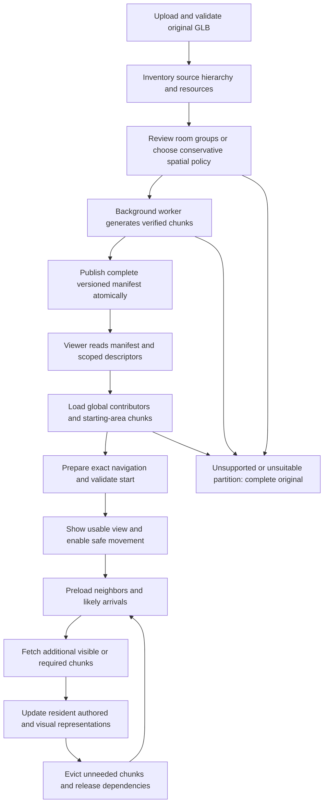

# GLB chunking and progressive rendering — phased implementation plan

Status: Implementation finalized through Phase 10 for reviewed static groups, with automated checks and explicit rollout/rollback controls. Production rollout defaults off pending representative building and physical-device acceptance. Phase 9 adds explicit opt-in intact-triangle spatial cells and remains disabled by default pending representative-model benefit and visual review. Imported scenes and layout placements stream visual chunks with exact readiness guards. Triangle cutting/interpolation is not implemented. This plan extends the runtime-asset processor, room streamer, quality controls and resource caches; it does not mark earlier performance phases or physical-device acceptance complete.

The goal is to process a large uploaded GLB into independently downloadable pieces, load the starting area first, preload likely destinations, render only relevant resident visuals and release unused resources. Original uploads remain immutable and available as a complete-scene fallback.

Related implementation documentation: [technical.md](technical.md), [runtime assets](docs/runtime-assets.md), [room streaming](docs/room-streaming.md), [spatial rendering](docs/spatial-rendering.md), [HQ rendering](docs/hq-rendering.md) and [performance phase plan](performace_phase.md).

## 1. What changes and what already exists

| Concern | Current implementation | Intended extension |
| --- | --- | --- |
| Upload | One self-contained GLB uploaded and validated | Keep the same upload flow |
| Processing | Whole-file quality variants and an exact collision proxy | Add verified chunk products and a versioned chunk manifest |
| Progressive loading | Separately uploaded GLBs assigned to layout rooms | Load pieces derived from one parent GLB, including imported 3D scenes |
| Rendering | Mesh frustum culling; eligible batching/LOD; template-room visibility | Apply conservative selection to imported chunks with reviewed metadata |
| Identity | Asset UUIDs and stable source child-index paths | Map chunk-local nodes and triangles back to source identities |
| Quality | DPR caps and whole-asset texture variants | Consistent per-chunk texture tiers and dependency-aware replacement |
| Cleanup | Shared decoded caches and room leases | Chunk/dependency ownership, eviction, obsolete derivative lifecycle |

Downloading an entire GLB and hiding meshes is not network streaming. Frustum culling can reduce submissions but does not free a decoded model. Splitting must create independently addressable payloads to reduce initial download and residency.

## 2. Proposed end-to-end flow



During an established streaming session, an individual neighbor failure blocks that area's entry and offers retry. Switching to the complete original is a controlled whole-scene fallback, not an automatic response that destroys the current view every time a speculative request fails.

## 3. Requirements that apply to every phase

- Keep original source bytes and existing scenes readable.
- Preserve model transforms, material assignments, UVs, skeletons, clips, hotspot attachments, floor approvals and exit destinations.
- Never infer approved floors from chunk bounds or an upward-facing surface alone.
- Keep visibility openings, walking exits and loading readiness as separate concepts.
- Block movement and arrival into incomplete areas even if a global collision index already knows their floors.
- Preserve a supported camera pose and animation timeline while chunks or quality tiers change.
- Treat crossing/animated/uncertain objects conservatively; load them globally or keep their complete dependency group together.
- Use source hashes, explicit mapping and verified output bytes. Do not identify a chunk by an expiring signed URL.
- Publish a complete validated output set through the existing attempt/lease ownership pattern.
- Record actual startup bytes, total visited bytes, decode/preparation costs and resource estimates. Do not claim savings based solely on hiding visuals.
- Keep existing database/public scope rules. Derived chunks belong to their parent asset; they are not unrelated uploaded assets.
- Production budgets remain unset until measured. Existing cache and concurrency values are starting heuristics.

## Phase 0 — Establish chunking fixtures and measurements

Implementation status: implemented fixtures, diagnostics and repeatable Chromium software-renderer baseline collection. Physical-device runs and shader/upload trace review remain pending; see [Phase 0 evidence and recording procedure](docs/chunking-baselines.md).

Prepare fixtures for an authored room hierarchy, one giant static mesh, shared materials/textures, objects crossing rooms, animation/skin dependencies, open-plan/window views, reviewed floors, attached hotspots and explicit exits. Include an asset too large for current processing admission to verify the original fallback.

Record complete-file baselines on the same viewport, scene revision, quality and devices:

- Bytes before first usable view, including textures and collision/occlusion data.
- Time to first rendered view and first safely usable walking view.
- Cold/warm decode, collision preparation and shader/upload stalls.
- Frame-time percentiles during sustained movement and turns.
- Resident geometry, decoded-resource estimates and texture inventory.
- Complete-tour transfer size and revisiting behavior.

Use current `?perf=1` tooling where possible. Add explicit chunk request/decode/readiness timestamps rather than deriving readiness from a download's completion alone.

Done when: repeatable fixtures and baseline reports exist, correctness reference scenes are established, and measurement fields distinguish network, preparation and rendering costs. Physical-device measurements must be labelled separately from Chromium software-renderer tests.

## Phase 1 — Define manifest, identity and compatibility contracts

Implementation status: implemented. Separate Go/TypeScript contracts, generated schema, strict structural/semantic validation and source-identity mappings are covered by shared contract fixtures. See [chunk contracts and source partition review](docs/chunking-contracts.md).

Define a separate processing version/schema for chunked outputs. Do not silently reinterpret existing `runtime-v1` manifests: current backend manifest structs and signing code explicitly describe whole-file variants and would need extension to preserve chunk fields.

The contract must describe:

| Field/category | Required meaning |
| --- | --- |
| Parent identity | Asset UUID, source SHA-256, processor version and partition revision |
| Coordinates | Whether bounds/transforms are source-space or prepared-world; never apply the model wrapper twice |
| Chunk identity | Stable ID within the manifest; immutable variant hashes |
| Partition metadata | Reviewed room groups, optional openings, global ownership and conservative fallback flags |
| Geometry inventory | Bounds, primitive counts, source surface mappings and coverage |
| Quality payloads | Low/Balanced/HQ descriptor references, hashes, bytes and texture estimates |
| Dependencies | Required textures, skeleton/animation groups and shared contributors |
| Navigation | Exact collision association and retained source floor identities |
| Occlusion | Exact required occluders and their authored material/sidedness semantics |
| Readiness | Dependencies required before displaying or admitting movement into an area |

An illustrative fragment, not a valid complete manifest or an existing API response. The strict complete contract is documented in [chunk contracts](docs/chunking-contracts.md):

```json
{
  "schema": "streaming-v1",
  "source_sha256": "<source digest>",
  "partition_revision": "<revision>",
  "coordinates": "source-space",
  "global_chunks": ["structure"],
  "regions": [{"id": "room-a", "chunks": ["room-a-geometry"]}],
  "chunks": [{
    "id": "room-a-geometry",
    "bounds": {"min": [0, 0, 0], "max": [4, 3, 4]},
    "dependencies": [],
    "surface_map": [{"source_path": "0/2/0", "chunk_path": "0/0"}],
    "variants": {
      "low": {"sha256": "<digest>", "bytes": 1000},
      "balanced": {"sha256": "<digest>", "bytes": 2000},
      "hq": {"sha256": "<digest>", "bytes": 3000}
    }
  }]
}
```

Those example byte values explain the shape; they are not proposed scene budgets. Durable manifests store validated private descriptors/keys; API delivery adds signed URLs after scope checks.

Keep source-path identity at the application boundary. A chunk's shorter local hierarchy must not invalidate existing material assignments or floor approvals. Shared or split source primitives may require triangle-range mappings, not only one node-to-node entry.

Done when: backend and frontend types, schema validation, coordinate conventions, migration strategy and source-identity mapping are specified and covered by meaningful contract checks.

## Phase 2 — Add author-reviewed partition metadata

Implementation status: implemented. Parent-owned source inventory and revisioned review metadata persist through private APIs, with an editor inspector and conservative complete-source fallback for uncertain dependencies. See [review workflow and validation](docs/chunking-contracts.md#author-review-and-persistence).

Start with explicit room/node ownership rather than claiming automatic room recognition from mesh names. Offer a partition inspector that shows loaded source bounds, node/surface identities, estimated payloads and global contributors.

Allow the author to group static nodes by room and review physical visibility openings. Reuse existing template ownership where trustworthy; imported 3D scenes need their own metadata and editor integration. Node names may suggest groups but do not constitute trusted floor or portal metadata.

Objects spanning rooms, shared walls, stairs, atriums, external views and unknown openings must have clear conservative policies. Keep a shared object once as a global/dependency chunk where possible; do not duplicate its visual/collision contribution into every room without accounting for overlap.

Animated/skinned nodes remain with their required hierarchy, joints and clips. Review partition settings in source coordinates and invalidate/recompute prepared bounds after model transforms. Tie partition products to source and partition revisions. Check how derivative hash availability interacts with existing bake review keys so publishing chunk products alone does not unexpectedly validate or invalidate a static bake.

Done when: metadata persists with a revision, invalid owners/openings are rejected, authors can inspect the resulting groups, and uncertain scenes visibly choose the complete/conservative path.

## Phase 3 — Generate chunks from intact authored node groups

Implementation status: implemented for reviewed static intact-mesh groups, including multi-primitive meshes with one owner. Animated, skinned, morphing and uncertain sources retain complete-original fallback. See [generation and delivery](docs/chunking-processing.md).

Extend the Node processor with partition inventory and independently exportable payloads. The first implementation moves whole eligible static node/primitive groups into chunks; it does not cut arbitrary triangles.

Preserve world transforms through explicit wrappers/mappings. Retain needed materials, vertex attributes, UV1, extensions and animation/skeleton dependencies. Oversized meshes that cannot be split safely remain global or make the source unsuitable for this stage.

Create Low/Balanced/HQ payloads per chunk using the existing supported processing tools and limits. Initially, self-contained chunks may repeat embedded textures; measure that duplication and disclose it. Do not claim shared-texture download savings before implementing a dependency scheme.

Validate:

- Every source contribution has declared ownership; no lost geometry or accidental duplicates.
- The union of chunks reconstructs the intended source transforms, materials, geometry and animation semantics.
- Source floor paths, material paths and hotspot references resolve through the manifest.
- Global/shared contributors cover all intended regions.
- Each output passes format validation and an actual runtime-loader inventory.
- Hashes and byte counts match generated files.

Keep the current worker admission/time/heap restrictions explicit. More output files require total-byte, output-count and manifest-size guards, plus meaningful processing-progress/error messages. Raising the 256 MiB source admission requires profiling; it is not an incidental side effect of adding chunking.

Done when: supported room-group sources produce validated chunks with stable mappings, unsupported sources keep the original path, and failure never publishes an incomplete manifest.

## Phase 4 — Add scoped chunk delivery and versioned job lifecycle

Implementation status: implemented with separate `chunks-v1` jobs, revision/attempt publication checks, and scoped on-demand private/public descriptors. Processor and scoped-handler tests pass; live PostgreSQL lifecycle and scoped integration checks pass; see [final acceptance](docs/chunking-acceptance.md). See [generation and delivery](docs/chunking-processing.md).

Extend worker/database records for partition revision and processing version. Reuse atomic claims, attempt UUIDs, leases and compare-and-swap publication. Upload all required products before exposing a successful manifest.

Extend private/public asset descriptors to advertise chunk manifests. Choose either signed descriptors in a bounded manifest or scoped per-chunk signing endpoints; avoid signing thousands of unused payloads at startup.

Possible new routes, subject to the Phase 1 contract:

```text
GET /api/v1/assets/{asset_id}/chunks/{chunk_id}?tier=low
GET /api/v1/public/tours/{slug}/assets/{asset_id}/chunks/{chunk_id}?tier=low
```

These routes are implemented; manifest, exact-index and dependency routes are documented in [generation and delivery](docs/chunking-processing.md). Resolve a chunk ID only through the current validated parent manifest; never accept arbitrary storage keys. Public requests must first validate the published tour's reference to the ready parent asset. Scope-preserving signed-URL refresh also applies to chunks and shared dependencies.

Keep original/whole-file variants accessible for older clients, unsupported sources and fallback. Partition changes must not expose stale products as current. Define source/partition revision conflicts and ensure a late worker attempt cannot publish over a newer configuration.

Done when: ready chunks have authorized, renewable delivery descriptors; unpublished, unrelated and malformed chunk requests fail; old manifests/scenes still load; worker recovery/cleanup is verified.

## Phase 5 — Integrate imported-scene streaming and safe bootstrap

Implementation status: implemented for reviewed static `chunks-v1` products (self-contained or declared shared-image dependencies) in preview/public/embed, including layout placements. Exact navigation and complete authored occlusion load first; movement and arrivals require committed visuals. Builder editing and legacy/unsupported products retain complete-source loading. See [viewer integration and checks](docs/chunking-viewer.md).

Add a streaming path for imported `3D` scenes and extend layouts whose instances reference a chunked parent. Current `StreamingLayoutControls` only streams independently uploaded asset IDs; it cannot consume internal chunk IDs unchanged. Use a parent/version/chunk/tier key without inventing asset UUIDs for derivatives.

Bootstrap from the validated saved start or requested portal arrival. Resolve its containing region and load global dependencies plus starting-area visuals. Retain a complete-scene fallback for missing/unsupported manifests.

For the first correctness implementation, evaluate loading a complete exact collision/occlusion contributor set at startup. This simplifies floor permissions and markers, but its bytes/preparation cost must count in the startup measurement. If it outweighs savings, plan regional exact indexes with halo/shared-wall contributors before claiming production benefit.

An exact collision proxy currently strips render material data. It is not automatically equivalent to authored hotspot occlusion. Preserve necessary occluder sidedness/visibility/material rules or provide a separately verified representation. Never let an unloaded wall expose an interactive marker through it.

Track readiness independently:

```text
Requested → Downloaded → Hash verified → Decoded
          → Dependencies ready → Exact navigation/occlusion prepared
          → Visuals committed → Area admitted for movement
```

The viewer needs a usable scene before walking is enabled. Streamed area bounds, including the capsule radius, stay blocked until required visuals and exact navigation data are committed. A collision-only floor does not authorize walking into a visually empty room.

Done when: imported and layout scenes can bootstrap without downloading the complete visual source, stable mappings preserve editing/content, and starts/arrivals/movement cannot enter missing geometry.

## Phase 6 — Add priority preloading and conservative visibility

Implementation status: implemented. Occupied areas, capsule halos, reviewed doorway rings, visible contributors and bounded movement lookahead have separate priorities. Speculative requests reserve a movement slot; decoding is serialized and commits are coalesced. Inspection/HQ request complete contributors, with HQ shadows deferred until ready. See [viewer integration and checks](docs/chunking-viewer.md).

Separate these sets in the scheduler:

| Set | Why it is needed |
| --- | --- |
| Resident | Already decoded and retained |
| Visible | Required for the current camera or supported rendering passes |
| Movement-required | Occupied area, capsule halo and immediate traversable neighbors |
| Prefetch | Likely next areas not yet strictly required |
| Pinned | Global structure, active animation dependencies or transition resources |

Give occupied-area/movement requests priority over speculative prefetch. Start with the existing two-request concurrency heuristic, then tune against measured network/decode work. Bound decode/commit bursts as well as download concurrency; fetching two files can still produce a large main-thread stall.

Preload an adjacent doorway ring regardless of look direction. Add bounded lookahead from position, movement direction and measured fetch/decode latency. Do not assume movement direction is stable or preload the whole graph. Handle teleport/reset, inspection and exit arrivals separately.

Use reviewed room openings to clip visibility through doorways/windows. For spatial cells without trusted room metadata, use conservative camera-frustum, movement halo and neighbor selection; do not infer occlusion from adjacency alone. Ambiguous camera positions and incomplete portal metadata must fall back conservatively.

Keep loading independent of render visibility. An invisible neighbor can be preloaded. A resident chunk can stop drawing while retained. Whole-mesh/batch frustum culling remains useful inside selected chunks.

HQ shadow passes currently need full contributors. Initially preserve that conservative requirement, or disable/defer the pass with clear policy while contributors load. Dynamic reflection capture is not implemented; future passes must explicitly declare their contributor set.

Done when: ordinary doorway turns/approaches are covered by preloading, aligned/nonaligned openings behave correctly, speculative work cannot starve movement and failures leave safe boundaries plus targeted retries.

## Phase 7 — Optimize texture dependencies and quality replacement

Implementation status: implemented for repeated static chunk image dependencies, scoped integrity-checked loading, compatible sampler sharing and retained quality replacement. See [textures and lifecycle](docs/chunking-lifecycle.md). Baked atlases retain existing ownership; real-upload atlas/animation acceptance remains pending.

Measure texture duplication in self-contained chunks first. When worthwhile, introduce content-addressed shared image dependencies and a loader policy that restores actual texture sharing.

External dependencies mean those products are no longer ordinary self-contained source uploads. Keep source upload validation unchanged; validate runtime dependency URLs/keys against the signed manifest. Do not enable arbitrary external GLB resource fetching to make sharing work.

Preserve color space, sampler transforms, UV channels, material extensions and baked atlas orientation. Track image bytes separately from sampler ownership. Reusing pixels with different samplers/color spaces does not guarantee one GPU allocation; inspect actual runtime behavior.

Choose consistent tiers across shared dependencies. Auto DPR trials must not trigger speculative texture-tier replacements. After a committed change, keep the prior usable tree, dependency leases, pose and animation timeline until replacement readiness, then commit and release it.

Baked atlas maps may be shared across several chunks. Preserve UV1 and revision associations; chunk movement/partition changes must not falsely certify a bake. Never crop/repack an atlas without updating UVs and validating the material semantics.

Done when: shared dependencies reduce measured duplicate delivery/residency where intended, role/sampler/atlas semantics remain correct, and repeated quality changes do not leak or dispose active resources.

## Phase 8 — Implement eviction, cancellation and derivative cleanup

Implementation status: implemented browser ownership, cancellation, timed hysteresis and durable storage retirement with retryable records. See [textures and lifecycle](docs/chunking-lifecycle.md). Live PostgreSQL trigger/cascade checks pass. Apply migration 016 before running the updated worker.

Use explicit ownership for chunks, shared geometry/images, animation groups, navigation/occlusion indexes and replacement trees. Required/pinned resources cannot be evicted to satisfy a soft envelope. Evict inactive candidates by recency/distance with hysteresis to avoid doorway thrashing.

Release room-level ownership immediately when safe; let shared caches dispose unowned decoded resources under their own policy. Dispose GPU buffers/material samplers and exact indexes through their owning layer. Returning to a room may reuse cached data or refetch through renewed scoped descriptors.

Drop obsolete queued prefetch requests. Only abort an in-flight transfer if no shared owner still requires it; a room change must not cancel a download needed by another placement. Late completions after scene unmount must release their leases exactly once.

Add a durable storage deletion/orphan lifecycle for obsolete partition revisions and deleted parent assets. Current database deletion does not reclaim all storage files. Protect products referenced by active/current manifests and honor signed delivery lifetimes when deciding retirement policy. Failed-attempt cleanup remains separate from successful old-version retention.

Done when: repeated scene/room/tier changes settle resource counts, no active resource is disposed, cancelled/late jobs remain consistent, and storage cleanup has retryable records and does not delete current outputs.

## Phase 9 — Optional spatial splitting of large static meshes

Implementation status: implemented as explicit opt-in `spatial_cell_size` for reviewed static groups with conservative visibility. Whole triangles, compact attributes, source-range mappings and source-derived exact indexes are retained. See [spatial mode and limits](docs/chunking-lifecycle.md#explicit-spatial-splitting). Disabled by default; real-model benefit, silhouette/lighting review and rollout evidence remain pending.

A source exported as one giant mesh cannot gain effective chunk granularity merely by grouping nodes. Add a separate, explicit processing mode if real uploads require it.

Prefer assigning intact triangles to cells when useful bounds and seams remain acceptable. Cutting triangles at cell boundaries requires interpolating every applicable vertex attribute, keeping material groups, normals/tangents/UVs, winding and source-triangle identity. Unsupported skinning, morphing, animation or material cases must remain intact/fallback rather than being cut approximately.

Account for oversized triangles and spanning objects: triangle-centroid assignment alone can give unexpectedly large chunk bounds. Avoid duplicate z-fighting, normal seams, bake atlas errors and collision gaps. Exact collision may stay independently source-derived while visual split geometry needs a separate validated identity mapping.

Do not enable this mode by default based solely on small fixtures. Review exported models, silhouettes, lighting and walking across cell borders before rollout.

Done when: supported static meshes reconstruct equivalent visuals with complete mappings, boundary cases are tested and measured benefits justify processing complexity and duplicated dependencies.

## Phase 10 — Validate, measure and roll out incrementally

Implementation status: finalized automated verification, live upload/worker/PostgreSQL/storage coverage, same-source cold/warm comparisons, version/feature rollout gates and rollback. See [final acceptance and procedures](docs/chunking-acceptance.md). The current full walking browser run passes the historical courtyard exit. Representative-building visual review, GPU traces, sustained physical-device runs and production budgets remain acceptance requirements; production defaults off.

Ship through an explicit feature/manifest-version gate with the complete source fallback. Start with reviewed room-group uploads. Expand only after evidence from representative uploaded buildings.

Validation must include:

- Worker interruption, stale attempts, deleted parents, failed writes and malformed manifests.
- Published/unpublished/private/public scope, expiration and refresh of chunk/dependency URLs.
- Builder, preview, public and embed; untouched legacy scenes and panoramas.
- Cold loads, slow connections, offline transitions, failed neighbors, rapid turns and teleport/reset arrivals.
- Approved floors, walls, narrow doors, gaps, stairs, exterior exits and safe return paths.
- Hotspot placement/visibility/attachments, material overrides, UV1 bakes and animation groups.
- Quality replacement during pending loads; hidden-tab pause/resume and animation continuity.
- Long room revisits, cache pressure, late completions and repeated disposal.
- Inspection and shadow-contributor completeness.

Compare complete-file and chunked modes on the same source, revision, device, quality and network conditions. Report startup bytes **including global textures and exact navigation/occlusion data**, first safely usable view, visited-tour transfer bytes, frame-time distributions, preparation stalls and memory proxies.

Done when: correctness checks pass, reviewed real scenes show repeatable useful savings, sustained physical-device runs meet established budgets, fallback is tested and rollback remains available. Resolve or clearly isolate the previously tracked courtyard-exit regression before claiming full walking acceptance.

## 4. Implementation sequence and integration points

| Milestone | Phases | Main integration points |
| --- | --- | --- |
| Define and review partitions | 0–2 | Diagnostics, scene/layout metadata, author inspector, manifest/schema types |
| Produce and deliver intact-node chunks | 3–4 | `asset-tools/process.mjs`, Go derivative worker, DB jobs, signing/public scope |
| Safely view imported chunks | 5 | `SceneViewer`, prepared model path, source mappings, navigation/occlusion, caches |
| Preload and select visible contributors | 6 | `roomStreaming`, `roomVisibility`, movement/arrival readiness, render passes |
| Reduce texture duplication and stabilize quality swaps | 7 | Texture dependency loader/cache, quality policy, material/bake preparation |
| Finish browser/storage lifetime management | 8 | Shared leases, cancellation, disposal and durable object cleanup |
| Handle giant meshes where justified | Optional 9 | Static geometry partitioning and identity validation |
| Establish production acceptance | 10 | Browser/full-stack regressions, physical devices, budgets and rollout gate |

Initial implementation should deliver verified authored-room/node chunks with a measured global collision/occlusion strategy. Automatic room inference, arbitrary triangle cutting, texture atlas repacking and new reflection effects are separate expansions; they are not prerequisites for the first useful streaming path.

## 5. Completion checklist

- [x] Baselines distinguish render culling from download/residency savings (software-renderer references; physical-device acceptance pending).
- [x] Versioned manifest and source mappings support old scenes and stable author references.
- [x] Reviewed partition metadata persists and conservative fallback is explicit.
- [x] Worker verifies a complete independently downloadable intact-static chunk set.
- [x] Private/public signing and URL refresh retain parent asset scope (scoped handler and live PostgreSQL integration checks pass).
- [x] Imported scenes and layouts bootstrap into a valid supported pose (generated-fixture browser checks; real-upload/device acceptance pending).
- [x] Preloading prioritizes movement and visibility without admitting missing geometry (unit and browser regressions).
- [ ] Materials, animations, baked maps and hotspots retain authored semantics.
- [x] Quality swaps and shared dependencies preserve active resource ownership (unit and generated-fixture browser checks).
- [x] Browser eviction/cancellation and retryable storage retirement implemented (live PostgreSQL retirement/cascade checks pass).
- [ ] Optional giant-mesh splitting implemented and separately tested; representative-model benefit and rollout evidence remain pending.
- [x] Automated Phase 10 verification, same-source measurement reports and rollout/rollback gates finalized.
- [ ] Real-upload visual review and sustained physical-device measurements establish acceptance.
