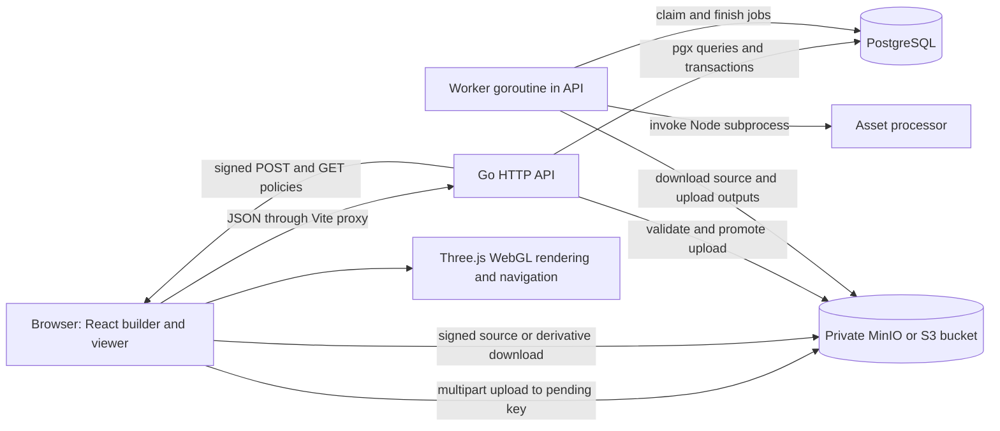
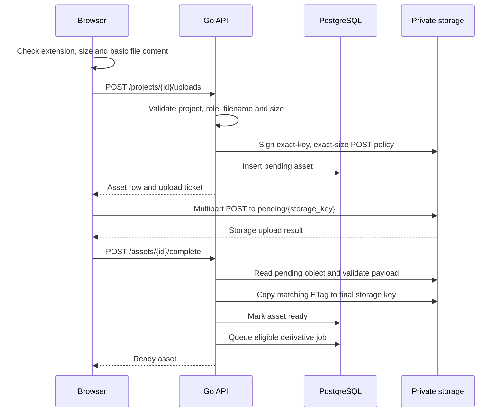

# Virtual Tour Studio: technical architecture and complete data flow

This document describes the implementation in this repository, from selecting an upload to rendering and navigating a published tour. It covers the Go API, PostgreSQL records, private object storage, background asset processing, React authoring interface and Three.js runtime, including the performance work through Phase 7.

The application is a proof of concept with a directly accessible builder. It currently has no authentication or per-user authorization layer. A project's UUID identifies its data; it is not an access-control credential. Public tour endpoints add publication and reference checks, but the ordinary builder endpoints remain accessible wherever the API is exposed.

The descriptions below distinguish implemented behavior from provisional limits and work still pending. The checked-in [performance phase plan](performace_phase.md) records implementation and acceptance status. The examples use placeholder identifiers, URLs and content; no environment secrets are required to understand them.

## Contents

1. [System architecture](#1-system-architecture)
2. [Startup, services and build](#2-startup-services-and-build)
3. [Persistent data model](#3-persistent-data-model)
4. [Coordinates, identity and revisions](#4-coordinates-identity-and-revisions)
5. [Upload flow](#5-upload-flow)
6. [Background runtime asset processing](#6-background-runtime-asset-processing)
7. [Scene creation and authoring](#7-scene-creation-and-authoring)
8. [Layouts and generated geometry](#8-layouts-and-generated-geometry)
9. [Materials, lighting and baked maps](#9-materials-lighting-and-baked-maps)
10. [Hotspots and explicit exits](#10-hotspots-and-explicit-exits)
11. [Publishing and public delivery](#11-publishing-and-public-delivery)
12. [Viewer initialization and asset decoding](#12-viewer-initialization-and-asset-decoding)
13. [Navigation, collision and movement](#13-navigation-collision-and-movement)
14. [Panorama viewing](#14-panorama-viewing)
15. [Quality, frame scheduling and animation](#15-quality-frame-scheduling-and-animation)
16. [Spatial rendering and progressive room loading](#16-spatial-rendering-and-progressive-room-loading)
17. [Caches, ownership and disposal](#17-caches-ownership-and-disposal)
18. [API reference](#18-api-reference)
19. [Limits and failure recovery](#19-limits-and-failure-recovery)
20. [Diagnostics, testing and acceptance](#20-diagnostics-testing-and-acceptance)
21. [Deployment configuration and troubleshooting](#21-deployment-configuration-and-troubleshooting)
22. [Source map and end-to-end examples](#22-source-map-and-end-to-end-examples)

## 1. System architecture

There are two primary data paths:

- **Metadata:** the browser talks to `/api/v1`, the Go API validates operations and reads/writes PostgreSQL.
- **File bytes:** the browser uploads and downloads through signed URLs directly against S3-compatible storage. Large source files do not pass through the upload-ticket JSON endpoint.

The background worker is a goroutine in the API process. It claims durable database jobs and invokes a Node.js processor as a subprocess. It is not a separate message broker or independently deployed worker service in the current Compose setup.



### 1.1 Main components

| Component | Implementation | Responsibility |
| --- | --- | --- |
| Browser application | React 19, React Router, TypeScript, Vite | Projects, uploads, scene editing, layouts, publication controls and shared viewers |
| 3D renderer | Three.js, React Three Fiber, Drei | GLB/panorama rendering, cameras, controls, HTML markers, animations and rendering effects |
| API | Go 1.26, `net/http` | JSON validation, storage signing, persistence orchestration and public access checks |
| Database access | pgx/pgxpool; sqlc-generated queries plus handwritten transaction helpers | Durable metadata, foreign keys, revision checking and worker job claims |
| Database | PostgreSQL 17 in Compose | Projects, assets, scenes, hotspots and explicit reference tables |
| Object storage | MinIO locally; S3-compatible client | Original uploads, pending uploads and runtime derivatives |
| Asset preprocessing | Node.js, glTF Transform, Meshoptimizer, Sharp, glTF Validator, Three.js | Verified Meshopt GLBs, image variants, exact collision proxies and manifests |
| Performance tooling | Browser instrumentation, Node unit tests, Playwright browser scripts | Frame/resource reports and feature regression checks |

The dependency manifests and lockfiles are authoritative for versions. The frontend pins Fiber 9.8.1 because its frame-loop compatibility patch depends on that exact release. The processor pins its own dependencies separately in `asset-tools/package.json`.

### 1.2 Routes and shared rendering

| Browser route | Purpose |
| --- | --- |
| `/` | Project dashboard |
| `/projects/:id` | Authoring workspace and visitor preview |
| `/t/:slug` | Published visitor tour |
| `/embed/:slug` | Compact published viewer for an iframe |

`ProjectScenes` and `PublicViewer` both lazy-load `SceneViewer`. Builder, preview, public and embed therefore use the same model preparation, walking, material, hotspot and quality code. Mode changes alter the available UI and delivery endpoints rather than maintaining separate rendering engines.

## 2. Startup, services and build

### 2.1 Compose startup

The local stack in [compose.yml](compose.yml) contains `postgres`, `minio`, `minio-init`, `api` and `web`.

1. PostgreSQL starts and passes its `pg_isready` health check.
2. MinIO starts with its object service and console.
3. `minio-init` retries connection, creates the configured bucket if absent and sets anonymous access to `none`.
4. The API starts after PostgreSQL is healthy and bucket initialization succeeds.
5. The frontend starts with `/api` and `/health` proxied to the API container.

Default host ports are web 5173, API 8080, PostgreSQL 5432, MinIO 9000 and MinIO console 9001. They are configurable. Database and storage data use named volumes. Stopping/recreating containers does not erase those volumes; removing the volumes does.

### 2.2 API startup

[cmd/api/main.go](cmd/api/main.go) performs these operations:

1. Create a signal-aware context for interrupt and SIGTERM.
2. Create the pgx connection pool from `DATABASE_URL`.
3. Ping PostgreSQL and apply migrations within a 30-second startup context.
4. Create the S3-compatible storage clients from environment configuration.
5. Start the derivative worker if `ASSET_PROCESSOR_SCRIPT` is nonempty.
6. Start the HTTP server, with a five-second read-header timeout.
7. On shutdown, stop serving with a ten-second shutdown context and cancel/wait for the worker.

`GET /health` checks PostgreSQL with a two-second timeout. It does not prove that object storage, processing or every browser feature is healthy.

### 2.3 Database migrations

[db/migrate.go](db/migrate.go) embeds `db/migrations/*.sql` into the Go executable. Startup applies ordered filenames in a transaction, guarded by a PostgreSQL advisory transaction lock. Applied paths are recorded in `schema_migrations`.

A filename is the migration identity. Editing an already applied migration does not make it run again. Schema changes belong in new migration files. SQL query sources live in `db/queries`; sqlc generates the corresponding Go query code in `internal/database`. Transaction helpers in that package implement operations that span multiple queries.

### 2.4 Container builds and installation hooks

The root Dockerfile builds the Go executable, installs the Node asset processor and copies both into a Node runtime image. The API runs as the `node` user. Node is required in the API image because the Go worker invokes the processor.

The frontend Dockerfile installs dependencies, copies application files and runs the TypeScript/Vite production build. Its runtime command currently starts the Vite development server; generating `dist` during the build does not turn this container into a production static-file server.

Frontend `npm ci` runs two `postinstall` operations:

- `patch-fiber-timer.mjs` installs the project Timer adapter in Fiber's ESM, development CJS and production CJS event bundles. The script rejects unexpected Fiber versions or bundle structure.
- `copy-asset-decoders.mjs` copies Three.js Basis JavaScript/WASM transcoder assets to `public/decoders/basis/`.

The Docker dependency layer must copy those scripts and `fiber-timer-clock.mjs` **before** `npm ci`, because lifecycle scripts run before the later `COPY . .`. Runtime KTX2 decoding uses the locally served transcoder files; it does not depend on a third-party decoder CDN.

## 3. Persistent data model

PostgreSQL stores configuration and references. Object storage stores the file payloads. Decoded models, GPU resources and navigation indexes are browser memory, not database rows.

| Table | Main fields and role |
| --- | --- |
| `projects` | UUID, name, description, timestamps, stable slug, publication flag and start scene |
| `assets` | UUID, project UUID, original filename, role, unique storage key, declared byte size, `pending`/`ready` status |
| `scenes` | UUID, project UUID, optional asset UUID, name, type, sort order, start camera, settings JSON, layout JSON and layout revision |
| `hotspots` | Scene/project identity, navigation/info type, position JSON, title, content, optional image and optional destination scene |
| `layout_asset_refs` | Durable links from layout scenes to their imported GLB assets |
| `scene_texture_refs` | Durable links from scenes to material maps, including the expected map role |
| `scene_portal_refs` | Durable cross-scene exit destination links |
| `asset_derivatives` | Asset/version identity, processing state, manifest, error, attempt UUID, lease expiration and timestamp |
| `schema_migrations` | Applied migration filenames |

### 3.1 Project and scene relationships

A project owns assets and scenes. A scene is one of:

- `3D`: references a ready GLB.
- `PANORAMA`: references a ready panorama image.
- `LAYOUT`: has no top-level asset; its JSON document describes generated structure and imported instances.

Composite project/resource foreign keys help enforce same-project relationships. UUID validity alone does not make an asset or destination usable.

Database triggers serialize scene insertion with project operations, assign sort order and choose the first scene as the default start scene. Scene lists are ordered by sort order, creation time and UUID. Reordering swaps neighboring scene positions in a transaction. Deleting the start scene selects another remaining scene when possible.

### 3.2 Why explicit reference tables exist

Material IDs, imported instances and exits live inside JSON documents, which ordinary foreign keys cannot directly traverse. Save operations rebuild relational reference tables from those documents. This allows deletion protection, publication validation and public asset scoping without trusting arbitrary JSON references during delivery.

The database validates ready status, asset role and project membership when creating these references. Layout saves update the document and reference rows in the same transaction. Imported-scene settings saves update material/portal references transactionally as well.

### 3.3 Deletion behavior

Individual referenced assets cannot simply be deleted. Scene asset references, hotspot images, layout imports and material maps protect the corresponding rows. Cross-scene portal references must be resolved before deleting their destination. Navigation hotspot destination foreign keys cascade when a scene is deleted.

Project deletion cascades its metadata and reference rows. The ordinary asset/project delete paths currently operate on database records; they do **not** implement comprehensive object-storage garbage collection. Removing a database row is not evidence that all original, pending or derivative objects were physically removed. The derivative worker has separate cleanup for outputs from unpublished/failed processing attempts.

## 4. Coordinates, identity and revisions

### 4.1 Coordinate conventions

The viewer uses Three.js world coordinates with Y up. Walking settings and generated layouts express distances in metres after preparation. Imported GLBs can require a scale conversion, Y/Z up-axis correction and yaw rotation.

Do not mix the two angle conventions:

- Model preparation, layout yaw and material rotation use **degrees** in authoring configuration.
- Saved camera yaw/pitch, panorama hotspot angles and exit arrival angles use **radians**.

A 3D camera contains `position: [x, y, z]`, `yaw` and `pitch`. A panorama camera contains yaw/pitch without position. Walking camera position is the eye location; floor elevation is approximately `position.y - eye_height`.

### 4.2 Stable surface identity

Imported mesh selections use child-index paths such as `0/0` or `0/2/1`, rather than names alone. Names can be duplicated. The processor checks that runtime variants keep equivalent runtime surface paths and exact geometry identity.

Layout instances also retain element UUIDs, so identical GLBs placed multiple times can have different materials, collision decisions and hotspot attachments. Render batching records source mappings back to these authored identities.

### 4.3 Different revisions serve different purposes

| Revision/identity | Purpose |
| --- | --- |
| Layout integer revision | Optimistic concurrency for persistent layout edits |
| SHA-256 source digest | Immutable runtime source identity and processing output association |
| SHA-256 variant digest | Browser and worker verification of derivative bytes |
| Runtime geometry identity | Reuse of exact navigation/collision preparation across equivalent quality variants |
| Bake review key, `bake-v1:…` | Detect whether external baked maps were reviewed for current authoring configuration |
| Performance scene fingerprint | Associate diagnostics with the sampled scene/configuration |

A bake review key is not a cryptographic integrity signature. A layout revision is not a content hash. A signed storage URL is a temporary delivery capability, not a permanent asset identity.

## 5. Upload flow

Sources: [ProjectScenes.tsx](web/src/ProjectScenes.tsx), [api.ts](web/src/api.ts), [assets.go](internal/httpapi/assets.go), [s3.go](internal/storage/s3.go).



### 5.1 Supported categories

| Asset role | Accepted payload | Main use |
| --- | --- | --- |
| `GLB` | Self-contained glTF 2.0 binary | Imported scene, furniture or building module |
| `PANORAMA` | 2:1 equirectangular JPG/PNG/WebP | 360° scene |
| `IMAGE` | JPG/PNG/WebP | Information hotspot artwork/image |
| `TEXTURE_BASE_COLOR` | JPG/PNG/WebP | sRGB material color |
| `TEXTURE_NORMAL` | JPG/PNG/WebP | Linear normal data |
| `TEXTURE_ROUGHNESS` | JPG/PNG/WebP | Linear roughness, green channel |
| `TEXTURE_AO` | JPG/PNG/WebP | Reviewed static AO, linear red channel |
| `TEXTURE_LIGHTMAP` | JPG/PNG/WebP | Reviewed indirect lighting, sRGB |

Image extensions normally infer panorama type. An explicit `IMAGE` or `TEXTURE_*` role changes the category and removes the panorama aspect-ratio requirement. A texture or hotspot image does not become a scene by itself.

### 5.2 Browser admission checks

Before requesting a ticket, the browser checks:

- Allowed extension and declared file size: at least 20 bytes; at most 1000 MiB for GLB or 100 MiB for images.
- GLB magic `glTF`, version 2 and header length equal to `File.size`.
- Image decoding through `createImageBitmap`.
- Image dimensions no greater than 8192 × 4096; panoramas additionally require width exactly twice height.

These checks provide immediate feedback, but the server repeats authoritative validation. Browser validation can be bypassed by a direct API caller.

### 5.3 Ticket creation

The browser sends JSON such as:

```json
{
  "name": "building.glb",
  "size": 123456,
  "file_type": "GLB"
}
```

The API checks the project, allowed type, size, supported extension and filename. Filenames are trimmed, limited to 120 characters and cannot contain `/` or `\`. It generates a UUID-based storage key instead of using the raw filename as an object path.

Typical final-key shapes are:

```text
projects/{project_uuid}/{object_uuid}.glb
projects/{project_uuid}/{object_uuid}.jpg
images/projects/{project_uuid}/{object_uuid}.png
textures/projects/{project_uuid}/{object_uuid}.png
```

`.jpeg` is normalized to `.jpg` in the storage extension. The original filename remains metadata.

The ticket contains an asset row and `{url, fields, expires_at}`. Its S3 POST policy expires after 15 minutes and specifies the bucket, `pending/` key, content type and exact declared content-length range.

### 5.4 Byte transfer

`uploadFile()` uses `XMLHttpRequest`, rather than `fetch`, to expose upload progress. It submits every policy field plus the file as `FormData`, with the signed content type. The request timeout is 15 minutes.

The browser must be able to reach the signed URL's host, and storage CORS must allow the browser origin. Vite's API proxy does not proxy these direct object-storage uploads.

Success at this stage means bytes reached the **pending** object. It does not mean the asset is ready for scenes or public delivery.

### 5.5 Completion validation

The API looks up the asset and calls storage `Confirm()`:

1. Read/stat `pending/{key}`.
2. Require exact declared size and category size limits.
3. Validate the file content.
4. Copy the object to its final key using the pending object's ETag as a copy-source condition.
5. Mark the database asset `ready`.
6. Queue processing for GLB or `TEXTURE_*` assets.

The conditional copy prevents promotion from silently using a different pending object than the one inspected. The original final bytes are preserved; validation does not rewrite them.

GLB completion validation checks the container header, total length, chunk alignment/length, first JSON chunk, glTF asset version and embedded/data-URI resources. The JSON chunk is limited to 8 MiB. An optional second BIN chunk is accepted; arbitrary extra chunk sequences are rejected. External image/buffer URLs are rejected. This is container/resource admission validation, not a proof that every material extension will work in the runtime.

Image validation reads the declared payload, checks that the detected format matches the filename extension, checks dimensions before full decoding and then decodes the pixels to catch truncation/corruption. Panorama aspect ratio is enforced only for panorama keys.

### 5.6 Completion retries and partial failures

Completion is idempotent for an already ready row: the API returns it and ensures eligible processing is queued without changing the original. If browser transfer succeeded but the completion request failed, **Confirm upload** can complete the existing pending asset.

Invalid or missing objects produce `422` on completion. The row remains pending. Upload/signing/database/object promotion are not one distributed transaction, so network/server failures can leave pending rows or objects requiring retry or cleanup. There is no automatic resumable/chunked upload workflow in this implementation.

A processing queue failure is logged after completion and does not make a valid original unusable. Authors can request processing later.

## 6. Background runtime asset processing

Sources: [worker.go](internal/derivatives/worker.go), [derivatives.go](internal/database/derivatives.go), [process.mjs](asset-tools/process.mjs), [runtime-assets.md](docs/runtime-assets.md).

### 6.1 Two independent state machines

```text
Upload:       pending → ready
Processing:   unavailable → queued → processing → ready
                                          └────→ failed → queued (explicit retry)
```

`unavailable` is an API representation for a missing/currently unusable derivative record, not a database worker state. A ready upload with failed processing remains a valid source asset.

The queue key is `(asset_id, version)`, currently `runtime-v1`. A repeat queue request preserves an existing successful/in-progress job; explicit retry resets a failed record to queued.

### 6.2 Claiming, leases and subprocess limits

The worker polls at three-second intervals when no job is available. A single worker loop processes one job at a time. Multiple API processes can claim different jobs using an atomic SQL statement with `FOR UPDATE SKIP LOCKED`.

A claim records a fresh attempt UUID and a 15-minute lease. Expired processing jobs become claimable again. A task has a ten-minute processing timeout, so ordinary task timeout precedes lease expiry.

The worker:

1. Creates a temporary directory.
2. Rejects sources above its 256 MiB processing limit. This is deliberately smaller than GLB upload admission.
3. Downloads the completed private source, enforcing its exact declared byte count.
4. Executes Node directly with `--max-old-space-size=1024`; generated local filenames are arguments, not shell fragments.
5. Captures bounded processor logs.
6. Validates the generated manifest and output files.
7. Uploads the complete output set.
8. Publishes the manifest through an attempt-matching database update.
9. Removes the temporary directory.

Node's heap limit is not a complete operating-system memory quota: native image buffers, decoded geometry and subprocess overhead can add memory.

### 6.3 GLB processing

The processor first validates the source with glTF Validator and reads it using glTF Transform. Its preprocessing support is narrower than the browser loader's support. For example, Draco, Basis/KTX2 and GPU-instancing source extensions are rejected for processing, even where an original can be supported by another runtime path. Unsupported processing leaves the original intact.

Processing currently requires triangle primitives and bounds primitive data. For each tier, it clones the source document and:

- Deduplicates accessors and prunes unused accessor/buffer data conservatively.
- Reorders triangle/vertex access for Meshopt without intentionally flattening the node graph, joining meshes or changing authored surface identity.
- Resizes embedded images to fit 1024, 2048 or 4096 pixels on the longest bounded dimensions, without upscaling.
- Emits PNG image pixels inside the derivative GLB.
- Checks a provisional aggregate RGBA8-with-mips texture envelope.
- Encodes Meshopt compression and validates the output.
- Decodes the encoded result and compares semantic snapshots and exact runtime geometry/surface inventories against the source.

The verification preserves authored transforms, materials, attributes, skins, animation data, oriented triangle geometry and runtime surface paths. Vertex/index storage ordering may change. The implementation does not assume compression is safe merely because the encoder completed.

| Tier | Texture dimension cap | Provisional aggregate texture estimate |
| --- | --- | --- |
| Low | 1024 | 64 MiB |
| Balanced | 2048 | 192 MiB |
| HQ | 4096 | 384 MiB |

The estimate is approximately `width × height × 4 × 4/3`, accounting for RGBA8-equivalent mip storage. It is not measured GPU VRAM. A cap violation fails processing rather than dropping authored textures.

### 6.4 Exact collision proxy

The processor also creates `collision.glb`. It removes render materials/textures and unnecessary attributes while retaining positions, relevant skinning attributes, position morph targets and hierarchy. It checks exact world geometry identity and source path/name mappings.

The manifest labels this proxy:

```json
{
  "strategy": "verified-exact-geometry",
  "floor_approval": "authored-only"
}
```

It is a verified alternate representation of exact geometry, not a simplified navigation mesh and not automatic approval to walk on every upward-facing triangle. Runtime reviewed floor decisions still apply.

### 6.5 External material texture processing

A `TEXTURE_*` source follows `processTexture()` instead of GLB processing. Sharp checks PNG/JPEG/WebP source metadata and creates Low/Balanced/HQ PNGs with the same dimension caps. It checks dimensions and alpha preservation and records hashes, bytes and texture estimates.

Panorama and information-image assets do not enter this derivative workflow. Baked-map texture processing resizes supplied pixels; it does not calculate AO or illumination.

### 6.6 Manifest and atomic publication

A manifest contains version, source SHA-256 and bytes, bounds/surface inventory, three variants and, for GLBs, a collision proxy. Variant entries identify hash, byte size, texture estimate and maximum texture dimension.

The Go worker independently hashes the source and each output and checks the expected filenames/manifest structure. Output keys include version, source hash and attempt UUID. Only after all writes succeed does it publish the complete manifest using a compare-and-swap-style update matching the current attempt and processing state.

If another attempt superseded the claim or the asset was deleted, publication fails. The worker cleans its attempted output keys when they were not published. A published manifest therefore does not expose a half-written tier set. Object storage and PostgreSQL still are not one transaction; a process killed outside normal cleanup can leave undiscoverable objects.

## 7. Scene creation and authoring

### 7.1 Creating an imported scene

The author selects a ready GLB/panorama asset or uses an upload-and-create dialog. `POST /projects/{id}/scenes` takes its asset UUID and a scene name. The database requires a ready same-project asset with scene-compatible role and derives scene type from that role.

Creation stores references and configuration. It does not embed the model into scene JSON or wait for background optimization. The original remains the loading path while derivatives are unavailable.

### 7.2 Model preparation

[sceneSettings.ts](web/src/sceneSettings.ts) clones the loaded hierarchy using Three.js's skeleton-aware clone utility, wraps it in a preparation group and applies scale/up-axis/yaw. Geometry and textures can remain shared, while editable materials are cloned.

Preparation applies material presets, registers reviewed navigation configuration and creates an animation mixer per prepared copy. It identifies actual animation-track targets so moving subtrees can be excluded from static bakes and selected for dynamic shadows. Two placements of one animated source have independent mixer state.

Dimensions and surface metadata are reported to the authoring interface. Imported models with no approved walking area remain inspectable; they are not automatically declared walkable.

### 7.3 Settings and camera saves

Scene settings include appearance, model preparation, material presets, surface assignments and optional walking configuration. The API validates bounded finite numbers and expected fields.

Settings and start-camera changes must be submitted separately. Appearance-only saves preserve a saved camera. Navigation changes clear the old saved camera. Changing scale/up-axis/rotation also clears reviewed navigation, moves world-position hotspots through the old-wrapper inverse/new-wrapper transform and clears the start camera in the same transaction.

This protects saved content from drifting out of alignment with the prepared model. It also means changing a model transform requires reviewing walking floors/exits and saving a new valid start view.

The browser maintains drafts, dirty flags and invalid-input feedback. Invalid numeric controls prevent save. A before-unload handler warns when builder drafts are unsaved. These draft behaviors do not implement collaborative real-time synchronization or global scene version history.

## 8. Layouts and generated geometry

Sources: [layout.ts](web/src/layout.ts), [layoutGeometry.ts](web/src/layoutGeometry.ts), [LayoutEditor.tsx](web/src/LayoutEditor.tsx), [layout_operations.go](internal/database/layout_operations.go).

### 8.1 Document structure

Layouts use a version 1 JSON document with element and doorway arrays, optional material presets and optional navigation settings. Element kinds include lobby, room, corridor, floor, wall and imported instance.

Generated structure is constructed in the browser. The document is the persistent source of truth; there is no server-generated building GLB for these templates.

An imported instance carries its own asset UUID, position, yaw, scale, appearance, collision setting, material assignments and, where applicable, approved floor paths and room ownership. Shared source geometry/textures are reused, but per-instance materials remain independent.

### 8.2 Authoring and validation

The floor-plan editor supports selection, grid snapping, moving/resizing, rotation, duplication, room additions, doorway editing and draft undo/redo. Validation checks geometry relationships before saving. Invalid drafts retain the last valid visible 3D model and explain the errors.

Template doorways physically cut the connected walls. Shared walls are coordinated so overlapping coincident boundaries do not simply become duplicate obstruction layers. Floors and walls receive authored collision metadata. Material UVs on template surfaces are expressed in metre-based world-aligned coordinates, so resizing and repeating compatible modules can preserve tile scale/alignment.

Limits include 200 elements, 200 doors and a 256 KiB create/save request envelope. Doorways require minimum walking clearance and valid touching room relationships. Unconnected geometry can produce warnings; structural overlaps or invalid door connections block saves.

### 8.3 Atomic revision saves

`GET /scenes/{id}/layout` returns `{document, revision}`. Saving uses:

```json
{
  "revision": 3,
  "document": {
    "version": 1,
    "elements": [],
    "doors": []
  }
}
```

The empty arrays above illustrate the envelope only; usable geometry requires an appropriate document.

The server takes the project transaction lock, checks the submitted revision, validates imported assets/materials/exits, locks attached hotspots, recalculates their world positions and saves the document with an incremented revision. Saving a layout clears the saved start camera.

A stale revision returns `409` and preserves the browser's draft. Removing an element with attached hotspots also fails unless those hotspots have first been detached or deleted. The document, reference rows and moved hotspot positions commit together.

### 8.4 Room ownership

An instance's optional `room_id` assigns its loading lifetime to a template room. It is not the navigation region permission itself. The editor only offers ownership where loaded bounds fit; edits to the object/owning room clear stale assignments. Structural imports spanning rooms, stairs and unknown open areas should remain globally loaded.

The backend verifies ownership references, but it does not calculate trusted containment from an unseen arbitrary upload. Runtime bounds/animation checks can make an assigned scene conservative and load it fully.

## 9. Materials, lighting and baked maps

### 9.1 Material presets

A preset contains UUID/name, map asset IDs, metre tile size, repeat, offsets, rotation, tint and scalar roughness. Presets are scoped to the scene/document, not a global material service. Imported assignments use surface paths; layout templates support separate floor/wall assignments and instance mesh overrides.

Material preparation clones source materials and map samplers. Base color is sRGB; normal and roughness maps are data textures without sRGB conversion. Roughness is read using the standard material's green-channel convention. Repeating samplers receive preset transforms; modifying one assignment does not mutate a cached source texture.

Materials require ready same-project images of the exact declared map role. Foreign, pending or mismatched-role maps cannot be made usable by inserting their UUID into JSON. Persistent references also participate in publication and deletion protection.

### 9.2 Common lighting

`SceneLighting` configures sRGB output, ACES filmic tone mapping, exposure and a PMREM-filtered `RoomEnvironment`. The PMREM source capture uses size 256. Ambient, hemisphere and directional light intensities derive from scene settings. The environment provides reflections; it is not dynamic per-room reflection capture.

Imported appearance overrides apply tint/roughness to prepared material copies. Generated layouts keep transforms and per-surface finishes in their element/material document rather than importing a global model transform.

### 9.3 Reviewed external bakes

External AO and indirect lightmaps require static imported surfaces with a valid second UV atlas (`TEXCOORD_1`, exposed as `uv1`). Generated template geometry currently has no reviewed bake atlas.

The author uploads maps, assigns a preset and chooses **Review baked maps for current scene**, then saves. The review stamp includes relevant asset, geometry, assignment, material and lighting context. Relevant edits make the stamp stale; stale external baked maps are not applied and are excluded from the scene's image-download set.

Exposure, quality and the optional dynamic-shadow toggle do not invalidate the bake. An empty review stamp is never accepted as an active bake, including when the fallback query disables new HQ paths.

Lightmaps must contain **indirect illumination only**, excluding the runtime direct key light. The shader hook replaces ambient/probe/hemisphere/environment diffuse contributions with the baked contribution. It preserves direct lighting and environment specular reflection. Applying a full-light bake without this authoring separation would double-count the direct contribution.

Lightmap samplers use sRGB, UV channel 1, GLTF image orientation (`flipY=false`) and clamped untiled coordinates. AO uses linear red-channel data and the same atlas channel. Avoid baking AO into the lightmap and then multiplying the identical AO again without visual review.

Moving subtrees, skinned/morphing meshes, invalid UV1 and stale maps fall back. External lightmaps also require stock standard-material shader behavior and reviewed maps for every submaterial of a mesh. Custom shader hooks/partially mapped material arrays retain their prior lighting. Applying/removing maps restores prior maps/hooks and releases owned samplers.

### 9.4 Provisional HQ shadows

The saved **Moving-object shadows in HQ** flag defaults off. Shadows require HQ, suitable capability hints and the new feature path enabled. Auto uses its committed effects tier, not a temporary DPR-trial tier.

Current limits: one directional light, 1024 × 1024 PCF map, ±8-unit camera-following footprint, depth 0.1–40, at most 24 nearby moving casters and 50,000 caster triangles. Candidates come from actual moving animation subtrees, skinning or morphing rather than every mesh of an animated building.

The capability gate requires `maxTextureSize >= 4096`; where reported, CPU cores and device memory must each exceed four. These are heuristics, not measured production budgets. No nearby eligible actors means no shadow target. Downgrade/unmount releases targets and restores mesh flags.

Shadow maps require all room contributors, so opting in can expand loading/residency beyond normal room streaming. The pass waits for contributor readiness. Screen-space AO and additional unbudgeted postprocessing remain disabled. See [hq-rendering.md](docs/hq-rendering.md) for visual and device acceptance requirements.

## 10. Hotspots and explicit exits

### 10.1 Three different connection mechanisms

| Mechanism | Geometry and activation | Purpose |
| --- | --- | --- |
| Layout doorway | Physical opening between generated rooms; ordinary continuous movement | Connect adjacent geometry in one scene |
| `NAVIGATION` hotspot | Clickable marker selecting another scene | Link scenes, including panoramas |
| Walking portal/exit | Locked threshold, proximity/visibility checks and validated arrival | Explicitly enter an exterior area or another 3D scene/region |

Visibility openings used by room culling are also distinct from walking exits. An exit does not create a visual hole in a wall or authorize unready geometry.

### 10.2 Hotspot placement and storage

A 3D hotspot has world x/y/z. A panorama hotspot has yaw/pitch. The author raycasts a surface to place a marker; panorama placement converts the inward-sphere hit into angular coordinates.

Layout hotspots may additionally store an attachment with an element UUID and local position. The server recomputes the world position from the saved element transform, rather than trusting inconsistent submitted world coordinates. Later layout transforms move attached markers atomically. **Keep at world position** removes that transform relationship.

Navigation hotspots require a same-project destination distinct from their source scene. Information hotspots instead support plain-text description, an optional ready `IMAGE` asset and an optional HTTP(S) link. Description/link/image content cannot be mixed into a navigation hotspot. Titles, text lengths, numeric positions, types and link formats are validated server-side.

Information content is rendered as plain text. External links are HTTP(S), have a host and cannot contain URL user credentials. Information popups stop pointer lock and pause movement. An information popup never grants exterior walking permission.

### 10.3 Visibility and reticle targeting

`HotspotVisibility` synchronizes the camera and authored occluder set once per rendered frame. Each marker first receives a full projected-frustum rejection. Surviving 3D markers use bounding-box rejection followed by exact raycasts toward the marker, with a small surface tolerance.

Cached answers are invalidated when view/projection, geometry, transforms, material-sidedness, hierarchy or occluder membership changes. Dynamic/deforming objects use conservative handling. The HTML marker and center reticle reuse the same result; they do not independently raycast every recursive scene tree.

The layer directly updates marker visibility when needed. While pointer locked, it chooses a visible target within a 44-CSS-pixel radius and activates it on click. Panorama markers use camera/frustum visibility without treating the enclosing image sphere as an occluding wall.

### 10.4 Exit configuration and activation

A portal stores UUID/label, eye-space activation position, threshold axis x/z, width, destination scene/region and arrival pose. Holding movement cannot cross a locked threshold. Activation requires the visitor to be within 1.5 metres and have a clear line of sight.

For a same-scene exit, the current exact navigation world validates the destination region and standing clearance. For a cross-scene exit, `validatePortalArrival()` obtains destination assets through the same builder/public scope, loads geometry, prepares the destination and validates the arrival before switching scenes. The loaded validation resources are disposed afterward.

The server verifies same-project 3D destinations and geometric region bounds from configuration and persists durable portal references. It cannot prove arbitrary uploaded mesh clearance from JSON alone, so the runtime exact-world validation is authoritative. Publication rechecks destinations after later edits. Failed validation leaves the current scene active with an explanatory notice.

## 11. Publishing and public delivery

### 11.1 Publish operation

Each project has a stable randomly generated slug and a `published` flag. Publish is an API/database operation, not a static-site export or an offline rendering job.

Publishing checks for a valid start scene, usable scene sources/layouts, ready same-project imported GLBs, matching ready material maps, valid navigation/image references and valid exit destinations. Structural validity is not proof of reviewed visual quality or sustained browser performance.

The share route is `/t/{slug}` and the iframe route is `/embed/{slug}`. Renaming, editing, unpublishing and republishing do not generate a new slug.

### 11.2 Public metadata and asset access

`GET /public/tours/{slug}` only finds a published project and returns name, description, start scene and ordered scene metadata/configuration. Hotspots and layouts have scoped read endpoints.

Public asset signing requires all of:

1. Published project with the requested slug.
2. Ready asset owned by that project.
3. A reference from a scene, hotspot image, layout instance or material map.

Unused library assets and foreign-project assets are not exposed merely because the caller knows their UUID. Signed public responses include the original URL and, where usable, derivative URLs. Storage keys/local processor filenames are stripped from the manifest; worker error details are suppressed in public derivative status.

Tour/asset/hotspot/layout delivery responses use `Cache-Control: no-store` where configured so permission and signed-URL reads are refreshed rather than indefinitely cached as API JSON.

### 11.3 Publication is live metadata

Publication is not an immutable snapshot. Saved edits appear when the public viewer fetches the updated records. An already open viewer holds loaded state and is not a live collaboration subscriber. Unsaved builder drafts are not made public.

Unpublishing prevents subsequent public metadata/signing reads. It does not revoke already issued signed GET URLs before their 15-minute expiry or erase bytes already downloaded by a browser. Changing a publication flag is not cryptographic recall of cached files.

## 12. Viewer initialization and asset decoding

### 12.1 Initial public load

1. `PublicViewer` obtains metadata using the slug.
2. It verifies a usable listed start scene and selects it.
3. It lazy-loads `SceneViewer` in visitor mode.
4. `SceneViewer` fetches scoped source descriptors and the scene's hotspots.
5. For layouts it deduplicates imported asset IDs and fetches their descriptors; it also collects currently needed material-map descriptors.
6. It registers asset identities and chooses quality/texture policy.
7. React Suspense waits for model/texture preparation; progress/error UI handles loading failures.
8. The shared Canvas mounts model/layout/panorama controls, lighting and hotspot overlays.
9. Exact navigation preparation determines whether walking can start at the saved or validated fallback pose.
10. Demand rendering draws the usable view and then continues only as required by interaction/animation.

Builder loading begins with project, asset-list and scene-list queries. It then enters the same renderer with editable controls and usually an inspection/plan state. Preview resets selection to the project's start scene and presents the visitor behavior.

### 12.2 Descriptor registration and quality selection

A descriptor has an original signed URL and optional runtime processing status/manifest. `registerAsset()` produces a logical key including delivery scope, asset ID, source hash/version and requested tier. Signed URL strings are not the sole decoded-cache identity.

Scene texture policy sums estimates for distinct source and material assets. If a requested tier exceeds the provisional envelope, it tries lower tiers and exposes unknown/over-budget diagnostics. It does not silently omit authored floors or textures to meet an estimate.

The active renderer's maximum texture size can also select a smaller derivative. Manual DPR quality, committed Auto asset tier and resulting aggregate asset policy are related but distinct; they can differ when capability or scene estimates constrain assets.

### 12.3 Integrity checks and fallback

For a ready supported runtime version, the model loader fetches derivative bytes and verifies their SHA-256 using `crypto.subtle` before parsing. Secure-context support is required for that verification. Ordinary insecure non-local HTTP origins fall back to the original path rather than bypassing integrity checks.

A failed/missing/corrupt derivative also falls back to the original. The exact proxy is loaded only when its metadata is accepted and the visual-plus-proxy delivery size is no greater than the source-byte envelope. Proxy failure retains the exact visual geometry as collision fallback.

If the original signed URL has expired or loading fails, the loader refreshes through the **same original project/tour endpoint** and retries the returned source URL. It does not turn a public scoped request into an unrestricted builder request.

External texture loading follows the same identity/integrity/fallback principles and can retain the original when a derivative offers neither byte-size nor dimension benefit.

### 12.4 Loader and decoders

`PreparedGLTFLoader`:

- Checks required extension metadata against explicit runtime support.
- Supports Meshopt through a bundled decoder.
- Configures KTX2/Basis with renderer-detected compressed-format support and two transcoder workers.
- Validates embedded texture references/dependencies.
- Reports missing images, malformed metadata and unsupported required extensions with import-specific messages.
- Rejects Draco assets and asks for uncompressed/Meshopt exports.

Browser support and offline preprocessing support are different lists. A valid container can still be rejected by preprocessing or by the runtime because of its extensions/content. The original fallback does not magically support an extension missing from the browser loader.

## 13. Navigation, collision and movement

Sources: [navigation.ts](web/src/navigation.ts), [TriangleIndex.ts](web/src/TriangleIndex.ts), [collisionGeometry.ts](web/src/collisionGeometry.ts), [WalkControls.tsx](web/src/WalkControls.tsx).

### 13.1 Authoritative geometry

The navigation world uses authored prepared geometry or its verified exact collision representation. It does not use simplified LOD triangles or visibility-hidden batch geometry as the authority for permission to walk.

`TriangleIndex` uses bounded spatial queries with Three.js triangle/capsule and ray predicates. Navigation preparation builds body-collision triangles and separate eligible floor indexes per reviewed region. Floor eligibility requires approved paths/generated floor metadata, allowed height range and slope. Roofs, tables and decorative upward-facing surfaces are not automatically floors.

Collision triangles are captured during world preparation and indexed for reuse. The current walking world does not refit that index every animation frame or provide a general rigid-body simulation. An animated visual object therefore does not establish moving-platform or continuously deforming collision support. Elements marked non-collidable are excluded from the body/floor preparation traversal.

Imported scenes require the author to review regions and floor mesh paths. Generated templates supply their floor metadata. Assembly/import workflows still require explicit suitable floor selection. Merely seeing a building does not imply walking is enabled.

### 13.2 Standing support and clearance

The walking body has a 0.22-metre capsule radius. Grounding checks the center and eight surrounding support samples, accepted floor heights, step limits, body contacts and vertical head clearance. A point with no approved support or insufficient clearance is not a valid standing location.

Unready streamed rooms add blocking bounds. The capsule/support radius cannot overlap those bounds, including while entering a doorway or restoring an arrival.

Saved starts and exit arrivals are validated. When possible, an invalid start is replaced by a verified safe point with a message. With no valid approved start, inspection remains available and walking stays disabled. Numerical recovery uses the last valid supported pose or a verified allowed-region fallback.

### 13.3 Motion integration

Movement input is normalized before speed is applied, so diagonals do not move faster. The simulation integrates at 120 Hz, caps work to 12 steps per update and bounds catch-up. Smooth movement accelerates/decelerates; editor behavior can use immediate motion.

Collision sweeps subdivide movement into at most 2.5-centimetre pieces. Failed full movement can slide along a contact plane or attempt component motion. Projected support-path coverage over approved triangles prevents small floor gaps from being skipped merely because their width is below a movement subdivision.

The renderer's frame clock prevents an idle/hidden pause from becoming a large movement jump. Blur, hidden tabs, pointer-lock release, popups and scene changes clear held inputs/velocity. Mouse look remains immediate; eye elevation can ease over small floor changes. Optional head bob follows actual travelled distance and respects reduced-motion preference.

### 13.4 Defaults and boundaries

Default speed is 2 m/s, eye height 1.65 m, step height 0.25 m and maximum slope 40°. Authors can choose validated ranges. Simple tested stairs and ramps do not establish support for every staircase, moving platform or multistorey building.

Exterior regions are locked until a validated explicit exit grants entry. Reset/restoration respects the entered exterior region; opening information does not unlock it. Quality changes preserve navigation configuration and pose rather than rebuilding permissions from visual detail.

## 14. Panorama viewing

`PanoramaControls` loads the image as sRGB and maps it to a sphere of radius 50 with 64 × 32 segments. Geometry is inverted so both rendering and hotspot-placement raycasts see inward-facing triangles. A basic material has tone mapping disabled; normal 3D lights do not relight the panorama pixels.

The perspective camera stays at the sphere center. Reset uses saved yaw/pitch and a 75° field of view. Drag changes angles, clamps pitch near the poles and normalizes yaw. Wheel and two-pointer pinch change FOV within 35°–90°.

A panorama is a fixed viewpoint with angular browsing, not free walking through reconstructed 3D geometry. Panorama scene links can lead to another panorama or a 3D scene through navigation hotspots. Walking exits require a 3D destination instead.

The panorama uses interaction activity to request frames; it does not require a permanent animation loop while static. Pointer state is cleared on blur/visibility changes.

## 15. Quality, frame scheduling and animation

### 15.1 Manual quality and persistence

Quality options are Auto, Low, Balanced and HQ. Manual preference is stored under `tour-render-quality` and shared across same-origin viewer routes/tabs. Storage failure leaves an in-memory usable session.

| Tier | Maximum pixel ratio |
| --- | --- |
| Low | 1 |
| Balanced | 1.5 |
| HQ | 2 |

Actual resolution is also bounded by the native device DPR. Quality changes preserve the camera and exact navigation world. Texture derivatives, aggregate scene envelopes, runtime LOD and optional HQ shadows are separate decisions layered onto the tier.

### 15.2 Auto controller

Auto starts at Balanced, or Low for very small reported texture capability. At most four cores or 4 GB reported memory limits its ceiling to Balanced and selects a provisional 30 FPS target; less constrained hints allow an HQ ceiling and 60 FPS target.

The controller has an eight-second warm-up and smooths continuous frame interval and CPU submission over approximately one second. Four sustained seconds above 135% of the target can trigger a one-tier DPR reduction, provided CPU submission is below a conservative cutoff and the next cap actually changes native resolution.

The four-second trial must improve average frame interval by at least 15%; otherwise it restores the prior tier. Idle/hidden interruptions also restore the trial. Trials have 30-second cooldowns, CPU-heavy samples defer changes for 15 seconds, and sustained headroom can allow gradual upgrades after a ten-second window with a 20-second cooldown.

This is a pixel-sensitivity experiment, not a GPU timer measurement. Auto commits expensive asset-tier changes only after accepting a trial, avoiding simultaneous texture downloads from confounding a temporary resolution experiment.

### 15.3 Demand rendering

`ViewerRuntime` owns a shared frame clock and a set of active render-task tokens. The Canvas uses `demand` when visible and `never` when hidden.

Frames are requested by edits, asynchronous readiness, view resets, pointer/key input, overlays, orbit damping, walking acceleration/braking, height smoothing, head bob and animations. A settled static scene stops requesting frames. A clip-bearing scene keeps frames scheduled even when the visitor stands still.

The first resumed simulation frame has zero elapsed navigation step. Navigation delta is bounded, and long visible stalls are recorded without being fully integrated as movement. Animation receives continuous visible elapsed time separately from the capped navigation step, pauses while hidden and does not catch up hidden elapsed time.

### 15.4 Animation ownership

Each prepared imported model or layout placement owns its mixer/clip state. Preparing a replacement variant reapplies the animation timeline and retains the standing/orbit pose where supported. Disposal stops mixer actions, uncaches the clone and releases owned resources. Cached uploaded source objects are not mutated into the live authoring model.

## 16. Spatial rendering and progressive room loading

### 16.1 Separate visual and authored trees

Preview/public/embed can prepare a visual tree for rendering; builder editing retains individual authored meshes. The authored tree remains available to exact navigation and hotspot occlusion. This separation allows render visibility and detail to change without approving a new floor or removing an occluding wall from interaction logic.

`?spatial=0` disables new batching/LOD for comparisons. When room culling is active, a separate visibility tree can still be required. `?streaming=0` selects complete loading and disables room culling.

### 16.2 Batching and instancing

Compatible opaque static meshes are grouped in 8-metre world-space cells. Shared geometry/equivalent materials can become instanced draws; other compatible groups can merge, with 65,536 vertices per group and 500,000 merged vertices per view.

Compatibility includes material maps/sampler identity, layers, render order, vertex schema, culling and shadow flags. Transparent, animated, skinned, morphing, mirrored, sheared and custom-shader content stays separate. Animated modules are conservatively excluded as whole subtrees.

Mappings from instance IDs or merged triangle ranges preserve authored surface/element identity. Fewer draw calls can come at the cost of coarser culling and more rendered triangles, so draw-call reduction alone is not proof of higher FPS.

### 16.3 Runtime LOD

Small repeated eligible decorations can receive medium/simplified index variants after Meshopt simplifier readiness. Targets are approximately 60%/30% index count subject to error limits; borders, normals and UVs constrain simplification. Processing is capped at 200,000 vertices.

Approved floors, structural-name matches, large objects and merged structure remain detailed. Projected sphere size chooses detail using 180/60 CSS-pixel thresholds and 15% hysteresis. Intersecting/nearby bounds retain detail. Full bounds stay conservative across variants.

These LODs are browser-generated products. They do not split uploaded geometry into downloadable LOD files or reduce source bytes on the network.

### 16.4 Visibility openings

Template room bounds and doorway rectangles supply the room visibility graph. The evaluator clips physical openings against the camera frustum and accumulated opening cones. An aligned series of doors may expose several rooms; a bent graph is not automatically fully visible.

Doorway/near-plane ambiguity is conservative. Bounded traversal falls back to the full view if work limits are reached. Shared wall visuals can belong to both room owners. Unknown exterior/orbit viewpoints and custom structural geometry without trustworthy opening metadata retain complete visibility/loading.

### 16.5 Progressive delivery

Independently addressable imported GLB assets are chunks, deduplicated by asset identity even when multiple rooms use them. The occupied room and globally loaded assets have priority; a doorway ring is preloaded regardless of look direction, followed by visible rooms.

There are two concurrent chunk load slots. The room cache aims for 12 entries but expands for the currently required set. Required assets are not evicted to satisfy a nominal soft limit.

Generated template structure stays resident. External material textures remain globally loaded for the scene. A monolithic GLB remains one file: hiding some of its visuals does not reduce its download or decoded memory. Authors must supply separate modules to gain delivery savings.

### 16.6 Readiness and conservative fallback

Initial controls wait for the occupied room and all global assets. Further rooms remain blocked until their assigned models are decoded and exact navigation preparation is ready. Failure exposes **Retry room loading** while retaining a blocking boundary.

A quality replacement retains the previous supported model/resource leases until the starting-area replacement is ready. Unsupported room assignment bounds, animation, stairs/open areas or shadow contributors can trigger full loading. Inspection requests the full scene. Current reflections use a static environment, not room-dependent dynamic capture.

## 17. Caches, ownership and disposal

These caches are in-memory browser structures. They are not a service-worker offline cache or persistent downloaded tour installation.

| Cache/resource | Key or purpose | Current soft policy |
| --- | --- | --- |
| Source descriptors | Scoped endpoint, asset, source/version and tier | Prune unowned old descriptors beyond 128, after 30-second age |
| Decoded GLTF | Logical asset key plus renderer capability profile | 12 entries / estimated 512 MiB; unowned 30-second grace |
| External textures | Asset key plus maximum texture size | 24 entries / estimated 256 MiB; unowned 30-second grace |
| Navigation data | Exact geometry/configuration identity | 8 entries / 500,000 cached triangles; evict unowned entries |
| Room chunks | Required modular asset set | Two active requests; retain about 12 unless required set is larger |
| Basis loaders | Per renderer | At most two transcoder workers per configured loader; disposable |
| Prepared materials/bakes/visual variants | Live prepared tree | Dispose owned clones/buffers/hooks on replacement/unmount |

Owner counts/leases prevent one viewer or room eviction from disposing resources still used elsewhere. The decoded renderer profile includes texture dimensions and supported compressed GPU formats; incompatible profiles do not blindly reuse a KTX2 decode.

The estimates account for geometry arrays and RGBA8-equivalent image storage, not every browser/driver/native allocation. Owned/required assets can exceed soft cache ceilings; these are eviction heuristics, not hard admission budgets.

Cached source geometry/materials/textures are released by cache disposal. Prepared material samplers and visual merged/LOD buffers are released by the prepared/visual tree that created them. Animation mixers are released with their clone. Navigation leases are released with the navigation world. Shadow maps and PMREM targets have separate effect lifetimes.

This ownership split is necessary because source reuse, multiple instances, streamed rooms and quality replacement can overlap. A generic recursive `dispose everything` on each UI unmount would invalidate shared resources.

## 18. API reference

All listed resource paths are relative to `/api/v1`, except `/health`. Browser `request()` sets JSON content type, decodes JSON success/error bodies and handles `204` without trying to decode a body.

### 18.1 Builder/project endpoints

| Method | Path | Operation |
| --- | --- | --- |
| GET | `/health` outside API prefix | PostgreSQL health |
| GET / POST | `/projects` | List/create projects |
| GET / PATCH / DELETE | `/projects/{id}` | Read/update/delete project; choose start scene via PATCH |
| POST | `/projects/{id}/uploads` | Create pending asset and signed POST ticket |
| GET | `/projects/{id}/assets` | List original asset metadata |
| GET | `/assets/{id}` | Asset metadata, original signed URL if ready, derivative status/manifest |
| POST | `/assets/{id}/complete` | Validate/promote pending upload |
| POST | `/assets/{id}/process` | Queue eligible processing or retry a failed job; returns 202 |
| DELETE | `/assets/{id}` | Delete unreferenced asset metadata |
| GET / POST | `/projects/{id}/scenes` | List/create imported or layout scenes |
| GET / PATCH / DELETE | `/scenes/{id}` | Read/edit/remove scene; PATCH name/order/camera/settings |
| GET / PUT | `/scenes/{id}/layout` | Read document/revision; atomic revision save |
| GET / POST | `/scenes/{id}/hotspots` | List/create hotspots |
| PATCH / DELETE | `/hotspots/{id}` | Update/remove hotspot |
| POST | `/projects/{id}/publish` | Validate and set published |
| POST | `/projects/{id}/unpublish` | Clear published flag |

The health row is included for operational context; the actual URL is `/health`, not `/api/v1/health`.

### 18.2 Scoped public endpoints

| Method | Path | Operation |
| --- | --- | --- |
| GET | `/public/tours/{slug}` | Published tour metadata and scenes |
| GET | `/public/tours/{slug}/assets/{id}` | Sign referenced ready asset and available variants |
| GET | `/public/tours/{slug}/scenes/{id}/hotspots` | Hotspots in a published tour's scene |
| GET | `/public/tours/{slug}/scenes/{id}/layout` | Published layout document/revision |

There is no separate public write endpoint or public process retry. The shared viewer changes its read prefix when `publicSlug` is present.

### 18.3 JSON and status handling

Most JSON requests are limited to 64 KiB; layout creation/save use 256 KiB. The API disallows unknown fields and trailing additional JSON objects in these request decoders. Configuration-specific custom decoders also reject invalid/null numeric data.

| Status | Typical meaning |
| --- | --- |
| 200 | Successful read/update/completion/publication |
| 201 | Created project/asset ticket/scene/hotspot |
| 202 | Accepted processing request |
| 204 | Successful deletion, no JSON body |
| 400 | Invalid input, reference, scene type or publish requirements |
| 404 | Missing resource or unavailable/unpublished public tour |
| 409 | Stale layout, attachment conflict or protected asset deletion |
| 422 | Pending object failed completion validation |
| 500 | Unexpected database/save/load failure |
| 503 | Storage unavailable/signing failure or failed health check |

Handlers map particular conditions individually; this table is an operational guide, not a guarantee that every reference conflict uses the same status. Errors generally have `{"error":"message"}` bodies, with detailed database failures logged server-side.

## 19. Limits and failure recovery

### 19.1 Main validated ranges

| Setting | Current range/limit |
| --- | --- |
| Project/scene/hotspot names | 1–120 trimmed characters where validated |
| Project/info description | 5000 characters |
| External info link | 2048 bytes; HTTP(S), host required, no URL credentials |
| Uploaded GLB | 20 bytes–1000 MiB |
| Uploaded image | 20 bytes–100 MiB; dimensions ≤8192 × 4096 |
| Panorama proportions | Exactly 2:1 |
| Worker source admission | 256 MiB |
| Model scale | 0.000001–1,000,000 |
| Model yaw | −180°–180°; up axis Y or Z |
| Exposure / environment / direct-light intensity | 0.1–4 / 0–3 / 0–5 |
| Roughness | Null/source value or 0–1 override |
| Material presets / imported assignments | 100 presets / 200 assignments |
| Tile size / repeat / offset / texture rotation | 0.01–100 m / 0.01–100 / ±1000 / ±360° |
| Walking speed / eye height | 0.25–6 m/s / 1–2.2 m |
| Step height / slope | 0.01–0.4 m / 0°–50° |
| Walking regions / exits | At most 100 each |
| Region coordinates / arrival coordinates | Within ±1000 m, finite |
| Reviewed region | Sides at least 0.5 m; valid floor band and approved mesh paths |
| Portal width | 0.8–10 m |
| Layout elements / doorways | At most 200 each |

Further element/path constraints are enforced in the specific validators. These values describe implementation admission, not recommended scene complexity for a target device.

### 19.2 Recovery by stage

| Failure | Retained state and recovery |
| --- | --- |
| Browser file check fails | No ticket requested; choose/re-export a supported file |
| Signed upload fails/expires | Pending row may exist; retry transfer with a valid ticket |
| Transfer succeeded, completion request lost | Use Confirm upload on the existing row |
| Completion validation fails | Asset stays pending; original is not promoted as usable |
| Worker disabled | Valid originals still load; jobs need an enabled worker to finish |
| Worker processing fails | Original stays ready; error appears in asset processing UI; explicit retry available |
| Worker dies while processing | Lease expires; another claim can recover the job |
| Derivative download/hash/parse fails | Loader attempts the original source |
| Collision proxy unavailable | Exact visual geometry remains collision input |
| Original signed URL expired | Refresh through original scoped endpoint and retry |
| Unsupported runtime extension | Import error; re-export with supported content |
| Layout revision stale | Draft stays local; reload/reconcile against current revision |
| Attached element deletion | Detach/delete its hotspots and save before removing it |
| Streamed room fails | Boundary remains blocked; retry room loading |
| Invalid saved start/arrival | Verified fallback where possible; otherwise inspection/error notice |
| Bake context changes | External maps inactive until appropriate regeneration/review/save |
| HQ capability/quality insufficient | Shadow pass remains disabled |
| Tour unpublished/missing | Public viewer shows unavailable state and retry action |

## 20. Diagnostics, testing and acceptance

### 20.1 Browser metrics

In a development frontend, `?perf=1` starts diagnostics before asset preparation. Metadata includes scene/configuration revision, viewer mode, quality, asset policy, browser, viewport and device label. `?device=...` can label a run but does not establish that it was measured on a physical device.

Metrics include frame-time median/p95/p99, CPU-submission proxy, renderer calls/triangles across passes, resource counts, texture inventory/estimated bytes, decode/collision timings, download timings and first usable view. Feature metadata records cache/streaming state, bake exclusions and shadow policy/cost estimates. JSON is available through the diagnostic UI and development `window.__tourPerformance` getter.

Idle wake frames are distinct from continuous frame samples. A static demand-rendered scene with no ongoing frames is not a zero-FPS regression. CPU submission includes synchronous rendering work and is not exclusive JavaScript CPU time; software-renderer reports and texture estimates are not physical GPU measurements.

### 20.2 Fallback switches

| Query switch | Comparison behavior |
| --- | --- |
| `perf=1` | Enable development instrumentation |
| `device=label` | Add an explicit measurement label |
| `spatial=0` | Disable new batching/LOD |
| `streaming=0` | Complete loading and no room culling |
| `hq=0` | Disable new external baked-map and HQ-shadow paths |

Use these to isolate an implementation path. They do not replace asset/reference validation or disable exact collision rules.

### 20.3 Test layers

- Go unit tests cover validators, storage admission and worker publication/cleanup behavior.
- PostgreSQL integration tests cover CRUD, persistence, publication, reference protection, transaction/revision behavior and settings changes. Without `TEST_DATABASE_URL`, database integration tests are skipped.
- Optional real-storage checks use `TEST_S3=1` plus storage environment configuration.
- Asset-tool tests verify source/variant semantics and processor output. The worker integration script exercises processing/delivery against its configured fixture environment.
- Frontend unit tests cover materials, layout geometry, navigation, hotspots, quality, cache ownership, spatial visibility and baked/shadow policy.
- Playwright browser scripts cover actual viewer integration, public/embed/preview modes, animation, fallback assets, quality, room readiness and rendered lighting behavior.

Representative commands:

```bash
go test ./...
go vet ./...
npm --prefix web test
npm --prefix web run build
npm --prefix asset-tools test

# Use the URL of the running source frontend, for example:
TOUR_ORIGIN=http://localhost:5174 npm --prefix web run test:hq-rendering
TOUR_ORIGIN=http://localhost:5174 npm --prefix web run test:room-streaming
TOUR_ORIGIN=http://localhost:5174 npm --prefix web run test:runtime-assets
TOUR_ORIGIN=http://localhost:5174 npm --prefix web run test:quality
TOUR_ORIGIN=http://localhost:5174 npm --prefix web run test:performance
```

Scripts that create real fixtures need a working API/storage stack. Some accept `TOUR_FRONTEND_ORIGIN` for a source-frontend proxy while retaining the deployment origin needed for storage CORS. Other scripts mock API/storage and verify mechanics independently. Inspect the selected test's environment expectations before treating it as full-stack evidence.

### 20.4 Current acceptance boundary

Performance Phases 1–7 have implementation evidence in the repository, but physical-device budgets and final visual acceptance remain pending. [performance-budgets.json](docs/performance-budgets.json) explicitly leaves required measured values unset. Null budgets do not mean a pass.

Short Chromium SwiftShader runs establish correctness, pass counts, cache behavior and software-renderer regressions. They do not establish sustained FPS, thermal performance, mobile VRAM or photorealism on production uploads. The recorded public courtyard-exit walking regression remains an acceptance item in the phase plan.

Current omissions include automatic splitting of monolithic GLBs, persistent download LOD generation, room-scoped external texture delivery, custom trusted window/stair/atrium visibility metadata, dynamic reflection capture, automatic lighting baking, offline screenshot/panorama rendering jobs and authenticated author permissions.

## 21. Deployment configuration and troubleshooting

### 21.1 Configuration boundaries

The application reads configuration from environment variables. Compose loads `.env`; code and documentation should not embed production secrets.

| Variable | Consumer/purpose |
| --- | --- |
| `DATABASE_URL` | API PostgreSQL connection |
| `HTTP_ADDR` | API listener, default `:8080` |
| `ASSET_PROCESSOR_SCRIPT` | Enables worker and identifies Node processor script |
| `S3_ENDPOINT` | API/worker internal object-storage endpoint |
| `S3_PUBLIC_ENDPOINT` | Browser-reachable host used for signed URLs |
| `S3_BUCKET`, `S3_REGION` | Storage target/signing configuration |
| `S3_ACCESS_KEY`, `S3_SECRET_KEY`, `S3_SESSION_TOKEN` | Optional explicit storage credentials |
| `WEB_ORIGIN` | Local MinIO allowed browser origin |
| `API_PROXY_TARGET` | Vite `/api` and `/health` proxy target |
| `BIND_ADDRESS` and service port variables | Compose host bindings |
| `TEST_DATABASE_URL`, `TEST_S3` | Integration test configuration |

If explicit S3 credentials are absent, the client uses an AWS environment/IAM credential chain. The API uses separate internal/public MinIO clients because the internal Docker hostname and browser-reachable hostname can differ. Endpoint URLs must have an HTTP(S) host and no non-root URL path. Storage requests use path-style bucket lookup.

For another physical device, `localhost` in a signed URL refers to that device, not the Docker host. Set a reachable `S3_PUBLIC_ENDPOINT` and matching browser origin. Secure HTTPS also matters for derivative integrity checks on non-local origins.

### 21.2 Operational diagnosis

| Symptom | First checks |
| --- | --- |
| Frontend JSON request fails | Vite proxy target, API listener, network and `/health` |
| API startup fails | PostgreSQL connectivity/migration logs and endpoint parsing |
| Signed upload fails | Browser Network entry, ticket expiry, storage host/CORS and exact policy fields |
| Completion returns 422 | Missing pending object, declared size, format, image dimensions or embedded GLB resources |
| Ready upload never processes | `ASSET_PROCESSOR_SCRIPT`, Node availability, queue state and worker logs |
| Processor rejects a large GLB | 256 MiB worker admission despite 1000 MiB upload limit |
| Runtime original loads but no variant | Processing state/version, integrity context, hash, texture capability and fallback reasons |
| KTX2 model cannot render | `/decoders/basis/` files, renderer configuration and supported texture formats |
| `npm ci` fails in Docker postinstall | All lifecycle script files must exist before dependency installation; Fiber pin must match patch |
| Building visible, Walk inside disabled | Reviewed region/floor paths, prepared coordinates and standing clearance |
| Exit destination rejected | Same-project destination, region identity, arrival band/clearance and saved configuration |
| Maps remain inactive | Current review stamp, UV1, static material eligibility and map role/status |
| Room stalls at doorway | Room assigned chunks, failed/loading state and retry; do not bypass the safety boundary |
| Public asset returns 404 | Publication flag, asset readiness, same-project ownership and actual scene/content reference |

The deploy script wraps Compose and supports service-specific rebuilds. Configuration, persistent metadata and object files have separate lifetimes: restarting a container, rebuilding an image, applying a migration and deleting a volume are different operations.

## 22. Source map and end-to-end examples

### 22.1 Where to investigate a behavior

| Concern | Primary sources |
| --- | --- |
| Startup/migration | [main.go](cmd/api/main.go), [migrate.go](db/migrate.go) |
| API routes/errors | [api.go](internal/httpapi/api.go), [assets.go](internal/httpapi/assets.go), [navigation.go](internal/httpapi/navigation.go) |
| Upload/signing/validation | [s3.go](internal/storage/s3.go), [api.ts](web/src/api.ts), [ProjectScenes.tsx](web/src/ProjectScenes.tsx) |
| Worker queue/publication | [derivatives.go](internal/database/derivatives.go), [worker.go](internal/derivatives/worker.go), [process.mjs](asset-tools/process.mjs) |
| Transactional scene/layout saves | [scene_operations.go](internal/database/scene_operations.go), [layout_operations.go](internal/database/layout_operations.go) |
| Public scope | [publication.go](internal/httpapi/publication.go), [publication.sql](db/queries/publication.sql), [PublicViewer.tsx](web/src/PublicViewer.tsx) |
| Viewer orchestration | [SceneViewer.tsx](web/src/SceneViewer.tsx), [ProjectScenes.tsx](web/src/ProjectScenes.tsx) |
| Loading/decoding/texture policy | [runtimeAssetCache.ts](web/src/runtimeAssetCache.ts), [runtimeTextureCache.ts](web/src/runtimeTextureCache.ts), [PreparedGLTFLoader.ts](web/src/PreparedGLTFLoader.ts), [assetPolicy.ts](web/src/assetPolicy.ts) |
| Imported preparation | [sceneSettings.ts](web/src/sceneSettings.ts), [materials.ts](web/src/materials.ts) |
| Layout geometry | [layout.ts](web/src/layout.ts), [layoutGeometry.ts](web/src/layoutGeometry.ts), [LayoutEditor.tsx](web/src/LayoutEditor.tsx) |
| Walking/floors/exits | [navigation.ts](web/src/navigation.ts), [TriangleIndex.ts](web/src/TriangleIndex.ts), [WalkingPanel.tsx](web/src/WalkingPanel.tsx), [portalValidation.ts](web/src/portalValidation.ts) |
| Hotspots | [HotspotLayer.tsx](web/src/HotspotLayer.tsx), [hotspotVisibility.ts](web/src/hotspotVisibility.ts) |
| Panorama | [PanoramaControls.tsx](web/src/PanoramaControls.tsx), [panorama.ts](web/src/panorama.ts) |
| Frame/quality policy | [ViewerRuntime.tsx](web/src/ViewerRuntime.tsx), [viewerQuality.ts](web/src/viewerQuality.ts), [walkingEffects.ts](web/src/walkingEffects.ts) |
| Batching/LOD/rooms | [spatialRendering.ts](web/src/spatialRendering.ts), [roomVisibility.ts](web/src/roomVisibility.ts), [roomStreaming.ts](web/src/roomStreaming.ts), [StreamingLayoutControls.tsx](web/src/StreamingLayoutControls.tsx) |
| Lighting/bake review | [SceneLighting.tsx](web/src/SceneLighting.tsx), [hqRendering.ts](web/src/hqRendering.ts), [MaterialEditor.tsx](web/src/MaterialEditor.tsx) |
| Diagnostics | [performanceMetrics.ts](web/src/performanceMetrics.ts), [PerformanceDiagnostics.tsx](web/src/PerformanceDiagnostics.tsx), [performance-baselines](docs/performance-baselines/) |

### 22.2 Example: an uploaded building becomes a walkable published scene

1. Create the project; PostgreSQL assigns its UUID and stable slug.
2. Select `building.glb`; browser checks its header/size.
3. Request an upload ticket; PostgreSQL records pending metadata and storage signs a 15-minute policy.
4. POST source bytes directly to the pending object and request completion.
5. API validates and copies the exact source to its final key; the row becomes ready and eligible processing is queued.
6. Create a `3D` scene referencing the ready asset. It can load immediately through the original.
7. Inspect the model, fix scale/up-axis/yaw, save preparation and review floor meshes/regions in the resulting world coordinates.
8. Assign materials, add information/navigation content and save a valid interior start view. Add explicit exits/returns where required.
9. If preprocessing succeeds, future asset descriptors expose verified Low/Balanced/HQ variants and the exact proxy. Failure keeps the original usable.
10. Publish. The API/database rechecks sources and references, then marks the project published without changing its slug.
11. A visitor loads `/t/{slug}`, receives scoped metadata/descriptors, verifies available derivative bytes, prepares the cloned model/navigation and starts at a validated pose.
12. Static views settle into demand rendering; input/animation wakes frames. Quality changes preserve pose. Render-only optimizations do not redefine floors or remove authoritative hotspot occluders.

### 22.3 Example: a modular layout streams rooms

1. Create a layout and edit generated rooms/doors, or assemble imported modules.
2. Upload independent room/furniture GLBs and add instances with their own transforms/materials/collision decisions.
3. Approve suitable imported floors where required. Assign contained static imports to template rooms; leave uncertain structural imports globally loaded.
4. Save using the current layout revision. Document, asset/material/portal references and attached hotspot world positions commit together; save a new start view.
5. Publish and load the tour in visitor mode.
6. The browser obtains descriptors for the referenced assets, then prioritizes globals/starting-room payloads and preloads neighboring/visible room payloads.
7. Unready room bounds prevent crossing into absent geometry. A failed chunk exposes retry without disabling collision.
8. A new ready set prepares exact navigation and a room-owned visual tree while retaining the supported camera pose.
9. Room visibility hides only visuals. Inspection, uncertain structure or opted-in shadows can request the full contributor set.

### 22.4 Example: a panorama with artwork and a 3D destination

1. Upload a correctly proportioned panorama and complete server validation.
2. Create its panorama scene; save the initial yaw/pitch.
3. Upload a separate `IMAGE` asset, complete it and attach it to an information hotspot placed by angular sphere hit.
4. Add a navigation hotspot pointing to a ready same-project 3D scene and publish.
5. The visitor loads the inward-facing sphere, drags/pinches the angular view and opens the plain-text/artwork popup.
6. Clicking navigation switches scenes and initializes the destination's 3D renderer. Free movement comes from that destination's reviewed geometry, not from the panorama image.

For deeper procedures and recorded limitations, see [runtime assets](docs/runtime-assets.md), [quality](docs/viewer-quality.md), [hotspot performance](docs/hotspot-performance.md), [spatial rendering](docs/spatial-rendering.md), [room streaming](docs/room-streaming.md), [HQ rendering](docs/hq-rendering.md) and [benchmark methodology](docs/performance-benchmarks.md).

## Reviewed monolithic chunking and rollout

The [GLB chunking plan](rendering_pland_phase.md) is implemented through its automated Phase 10 handoff. `chunks-v1` is independent of `runtime-v1`: author-reviewed partitions queue revision/attempt-owned products with stable source mappings, scoped on-demand descriptors, exact-index readiness and declared content-addressed image dependencies. The viewer retains supported pose/resource ownership through quality changes, prevents entry into incomplete areas and releases obsolete requests through shared leases. Migration 016 records retryable storage retirement independently of deleted parents. Experimental `spatial_cell_size` splits only intact static triangles and preserves source-derived exact navigation/occlusion.

The API defaults to `ASSET_CHUNK_STREAMING=off`; `reviewed` admits intact static products and `spatial` additionally admits explicit experimental cells. Viewer build and query rollback are `VITE_CHUNK_STREAMING=0` and `?streaming=0`. Unknown schema/processor advertisements retain complete loading. [Final acceptance](docs/chunking-acceptance.md) records local PostgreSQL/worker/storage/browser checks and complete/chunked cold/warm comparisons. Full authored occlusion remains startup-global, so these small generated fixtures do not show startup-byte savings; production and physical-device acceptance remain held.
